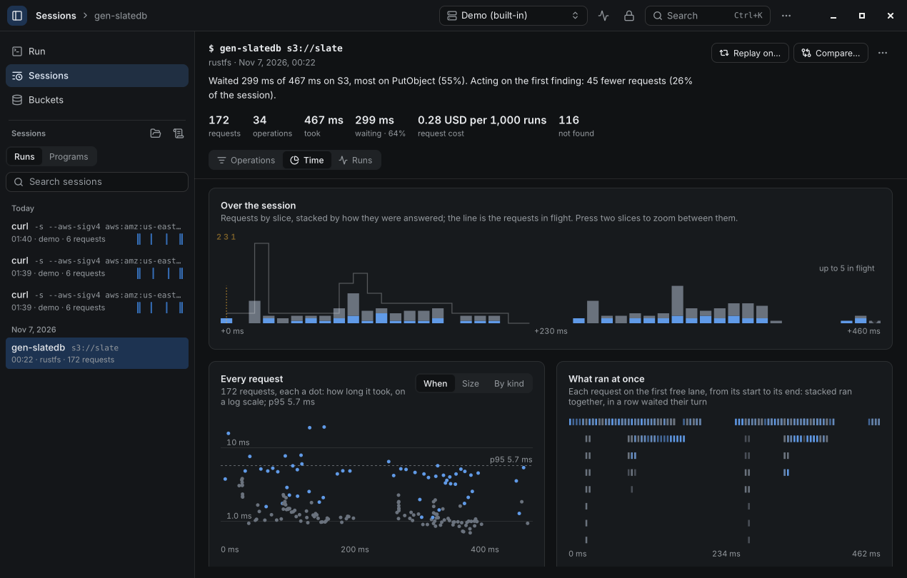
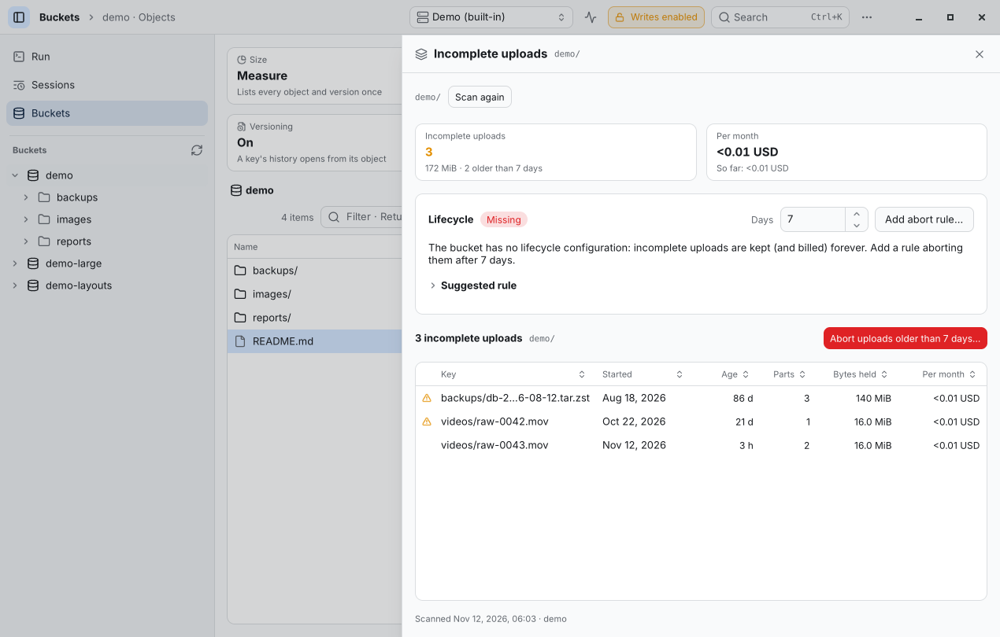
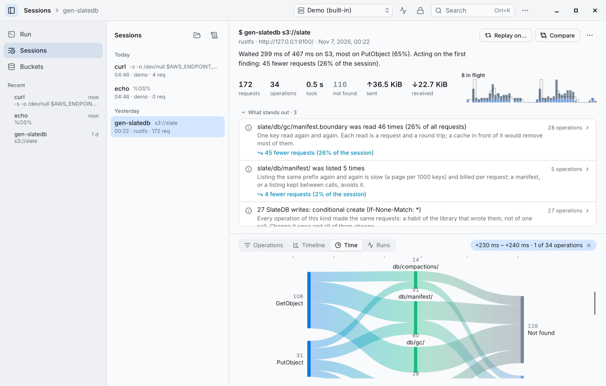
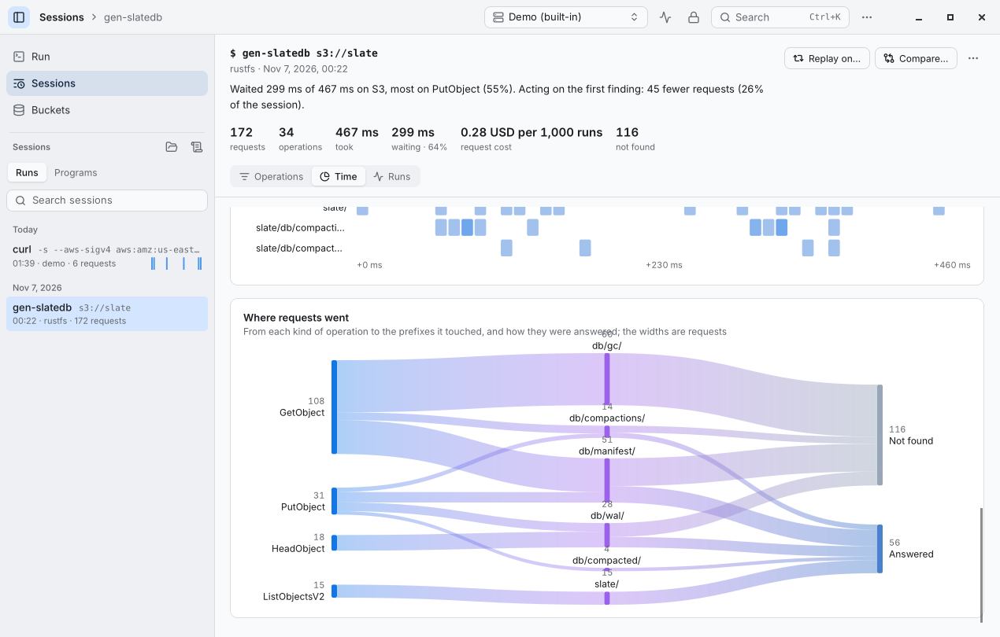
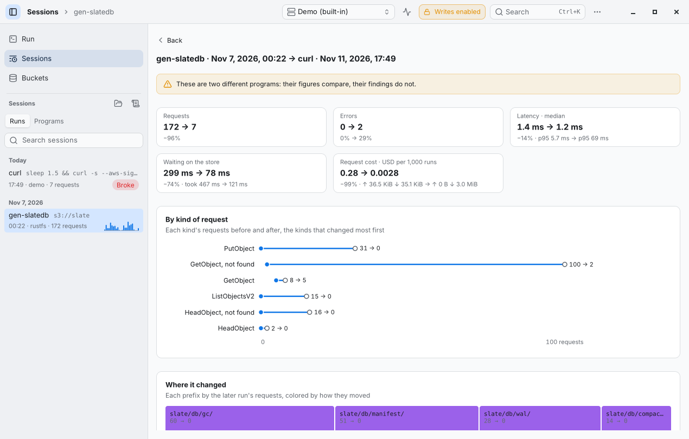
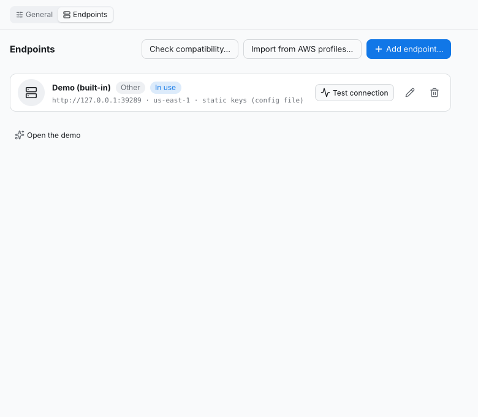
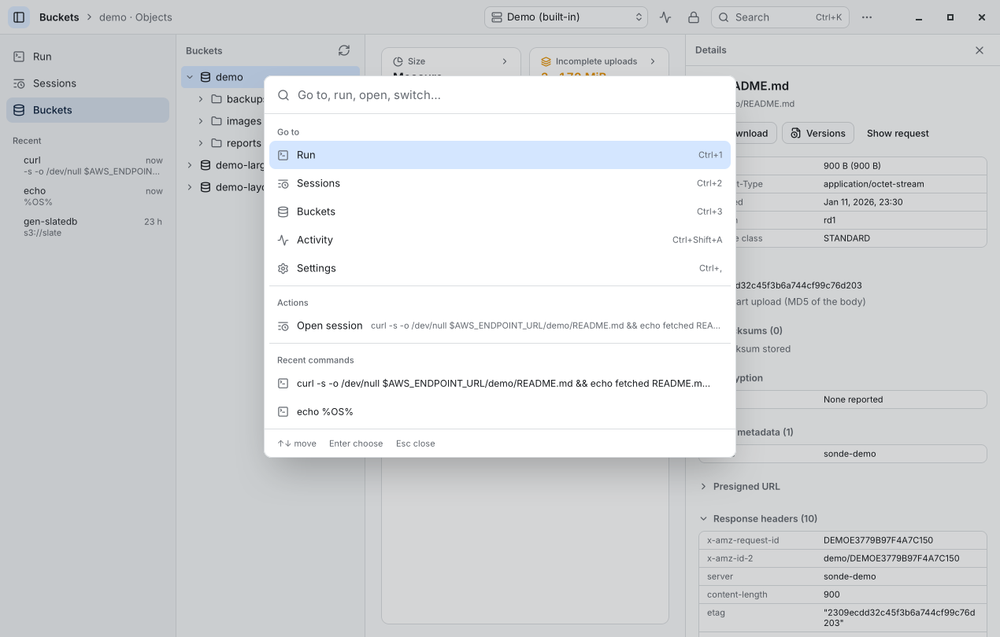

# sonde

**See what your software does to S3.** Run an application through sonde and read its object-storage traffic as
operations — a SlateDB manifest write, an Iceberg commit, a multipart upload — then replay the same traffic on
another endpoint and see where the two disagree.


```sh
sonde run -- ./my-app                    # record every S3 request my-app makes
sonde show                               # … as operations, with what stands out and where the time went
sonde run --trial -- ./my-app            # … then again while S3 misbehaves: did it survive?
sonde compare before.sonde after.sonde   # what a change did: requests, waiting, cost, findings
sonde check --baseline auto             # in CI: exit 1 when a run is over its budget or past its program's baseline
sonde replay session.sonde -e ceph       # the same traffic on another store: what differs?
```

```
00:22:25.074  SlateDB  looked for the newest WAL: probed ids 1…128        8 reqs · 5 ms
00:22:25.085  SlateDB  WAL 1 written empty (fencing marker)              2 reqs · 9 ms  · after 1 lookup that found nothing
01:09:10.149  Iceberg  commit: table metadata v2 · 3 files (7.6 KiB)    20 reqs · 112 ms
01:09:10.597  Iceberg  1 file written, no commit followed (72 B)          3 reqs · 18 ms

116 requests (6 operations) to rustfs in 0.7 s · ↑58.1 KiB ↓62.6 KiB
! files were written with no commit after them: orphans unless a later commit adds them
· 21 files under 5 MiB were uploaded as multipart uploads: 3 requests each where one PUT would do
```

## What it does

**Record and understand**

- `sonde run -- <command>` (or **Run** in the app) records every S3 request through a local endpoint. sonde signs
  with the real credentials, which never reach the program; `--no-delete` and `--read-only` limit what it may do.
- Requests are read as **operations**: multipart uploads, retries, listings, and the steps of SlateDB, Iceberg,
  Delta Lake and Lance.
- **Findings** say what deserves a look (hot keys, HEAD before GET, throttling, unfinished uploads, orphaned files,
  slow requests…), what fixing them would save, a fix in Python, Java, Go or JavaScript, and, with `--callers`,
  the line of your code that sent the requests (Python, Node.js and Java).
- **Four signals** head every run, in the app and in `sonde show`: rate, errors, latency and bytes, each with
  its line over the session (and how many requests were in flight); under them **a table per operation**:
  requests, the share that failed, p50, p95 and p99.
- **Where the time and money went**, on one board under one timeline: bytes a second each way, p50, p95 and p99
  over time, the first byte against the rest, errors and retries by class, sizes and MiB/s, waiting by kind of
  request, every request on a log scale, latency as a heat map, what ran at once lane by lane, prefixes against
  S3's per-prefix limit, the cost by operation. Every chart over time shares one axis and says its scale.
- **Sessions of any size**: a million requests are read in seconds (`show` in 7 s and under 2 GiB), and the app
  opens a session at its first screen and reads the rest as you scroll.
- **Production traffic**: `sonde import` reads S3 access logs, CloudTrail and HAR files the same way.

**When the store fails**

- `sonde run --trial` runs the command again while sonde answers in the store's place — a 503 on each request's
  first attempt, a write whose answer is lost, a failed CompleteMultipartUpload, a download cut half way, a
  conditional write that loses its race — and says whether the program **survived**: whether it retried, how
  long it waited and whether the waits are jittered, how much it multiplied the load, what it left behind. When
  it **broke**, the verdict names the request, the line of code and the SDK setting to change.
  `--fault slowdown:3` presses harder; `[[scenario]]` in `sonde.toml` adds a project's own;
  `sonde check` fails when the program broke. In the app, **Try under faults…** does the same and a trial opens
  as a session with the injected requests marked. See [docs/trials.md](docs/trials.md).

**Programs and CI**

- Runs of one program (its `name` in `sonde.toml`, else its command) are tracked against a **baseline**. `sonde check` fails a CI job when a run is over its
  budget (requests, waiting, cost, errors, p95) or past its baseline; findings you keep on purpose can be
  `expect`ed.
- The app says since which run and commit a program got worse, and shows the code that changed in between.
- `sonde check -f markdown` writes a pull request comment; `-f github` annotates the lines that sent the requests.

**Compare, replay, share**

- `sonde compare` shows what a change did: requests, waiting, cost, findings, and where by prefix.
- `sonde replay` re-enacts a session on another store and compares every answer.
- `sonde share` turns a session into a web page or a single HTML file (`--redact` to send outside).

**Your stores**

- Browse 100 000+ objects with every header, checksum and version; find incomplete uploads and their cost; see why
  a bucket is this big.
- 40 compatibility probes across endpoints (AWS, R2, MinIO, Ceph, OSS, …) as one matrix.
- Decode SlateDB, Iceberg, lakeFS and Woodpecker layouts.

**Safe by default**: read-only until you turn it off; anything destructive needs a dry run and a typed
confirmation, and goes to an audit log. Credentials stay in Rust, logs are redacted, and there is no telemetry.

One codebase, three forms: a **desktop app** (macOS, Linux, Windows), a **terminal UI** in one static binary, and a
**CLI** for scripts and CI. The UI is [Native Shell](https://github.com/longbridge/nsh); everything else is Rust.
English and 中文.

## The app

**Run** is the home: type a command, and its terminal and its requests appear side by side. **Sessions** keeps every
run and every file you open, drop on the window, or double-click in the system (`.sonde`). **Buckets** browses your stores. The sidebar lists what the place
has (the commands run before, the sessions, the buckets); a detail opens beside it and nothing else moves. ⌘K opens everything; Settings
are a window of their own (⌘,). The terminal UI (`sonde tui`) has the same places: `:` for the palette, Esc to go
back. Design standards: [app/DESIGN.md](app/DESIGN.md).

| | |
|---|---|
|  |  |
|  |  |
|  |  |
|  |  |
|  |  |

What each version changed is in the [changelog](CHANGELOG.md).

## Install

```sh
curl -fsSL https://raw.githubusercontent.com/hxddh/sonde/main/install.sh | sh     # Linux and macOS terminal binary
brew install hxddh/sonde/sonde                                                   # the same, with Homebrew
brew install --cask hxddh/sonde/sonde-app                                        # the macOS app
```

Or download from [Releases](https://github.com/hxddh/sonde/releases) (checksums in `SHA256SUMS`):

- terminal binary: `sonde-{linux,macos}-{x86_64,aarch64}.tar.gz` (Linux also as static `…-musl`), needs only libc;
- desktop app: `sonde-macos.dmg`, `sonde-<version>-linux-x86_64.tar.gz` (GTK 4), `sonde-<version>-windows-x86_64.zip`.

## Quick start

```sh
sonde demo                              # a tour on a built-in store, no account needed
sonde endpoints import                  # your ~/.aws/config profiles as endpoints
sonde run --callers -- python etl.py    # record a program's S3 traffic, naming the code that sent it
sonde show                              # the newest session, as operations and findings
sonde run --trial -- python etl.py 's3://scratch/etl-{trial}/'   # the same run under faults: survived, degraded or broke
sonde check --init                      # a sonde.toml budget this run passes, for CI
sonde import access.log                 # production traffic (access logs, CloudTrail, HAR)
sonde share --html --redact -o run.html # one HTML file, names replaced, safe to send
sonde tui                               # the terminal UI
```

Headless, for scripts and CI ([docs/cli.md](docs/cli.md), with exit codes):

```sh
sonde probe -e minio -e r2 -b scratch-bucket --format markdown -o report.md   # exit 1 on a failed probe
sonde mpu scan -e prod -b logs                                                # exit 4 when stale uploads or no rule
sonde du -e prod -b logs --format json
sonde layout inspect -e prod -b lake -p warehouse/db/events/                  # detect and decode
sonde --url http://127.0.0.1:9000 --path-style probe -b scratch --only checksum.
```


## Documentation

| | |
|---|---|
| [Configuration](docs/configuration.md) | `config.toml`: settings and endpoints |
| [Credentials](docs/credentials.md) | Where credentials come from, and how they stay out of the UI |
| [Recording](docs/recording.md) | Run, `sonde run`, `sonde proxy`, `sonde show`, `sonde share`, session files |
| [Trials](docs/trials.md) | `sonde run --trial`: fault scenarios, what is read from a run under them, `[[scenario]]` |
| [CLI](docs/cli.md) | Subcommands, formats, exit codes |
| [Probes](docs/probes.md) | Every probe and the AWS behavior it checks |
| [Decoders](docs/decoders.md) | The layouts and format versions each lens decodes |
| [Security model](docs/security.md) | Credential isolation, read-only mode, what runs where |
| [Performance](docs/performance.md) | Measured numbers |
| [Architecture](docs/architecture.md) | Crates, threads, data flow |
| [Decisions](docs/decisions.md) | Product decisions and why |
| [Packaging](docs/packaging.md) | Builds, signing, notarization, release |
| [FINDINGS.md](FINDINGS.md) | Native Shell gaps met while building sonde, and the workarounds |

## Development

Rust 1.95 or newer builds sonde; what links Native Shell needs 1.97, its own minimum since the pinned commit: the
app's crate (`sonde-nsh`), `sonde tui` (the `tui` feature) and the `nsh` CLI that bundles the app and runs its UI
tests (installed from Native Shell at the pinned commit, `docs/decisions.md` D-002). CI builds with stable.

```sh
cargo test --workspace                       # unit tests (SigV4 vectors, redaction, parsers, judges, decoders)
scripts/integration.sh                       # Ceph RGW and RustFS in docker compose (MinIO with MINIO_IMAGE)
scripts/ui-tests.sh                          # nsh test, desktop and terminal forms and the web viewer, headless
cd app && nsh run --target tui               # the TSX app with hot reload
cargo run -p sonde-cli --features tui -- tui --demo
```

Licensed under Apache-2.0.
