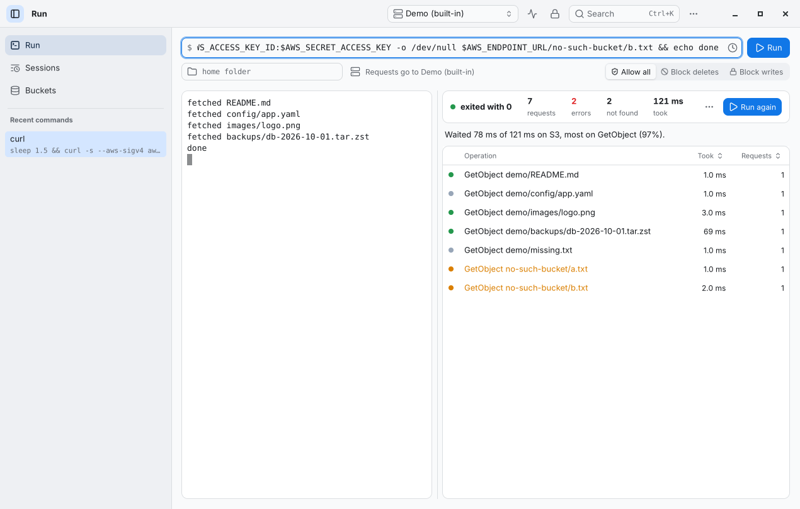
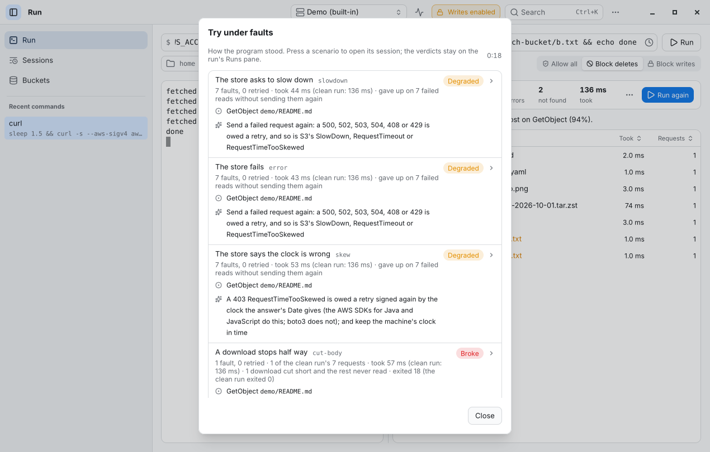
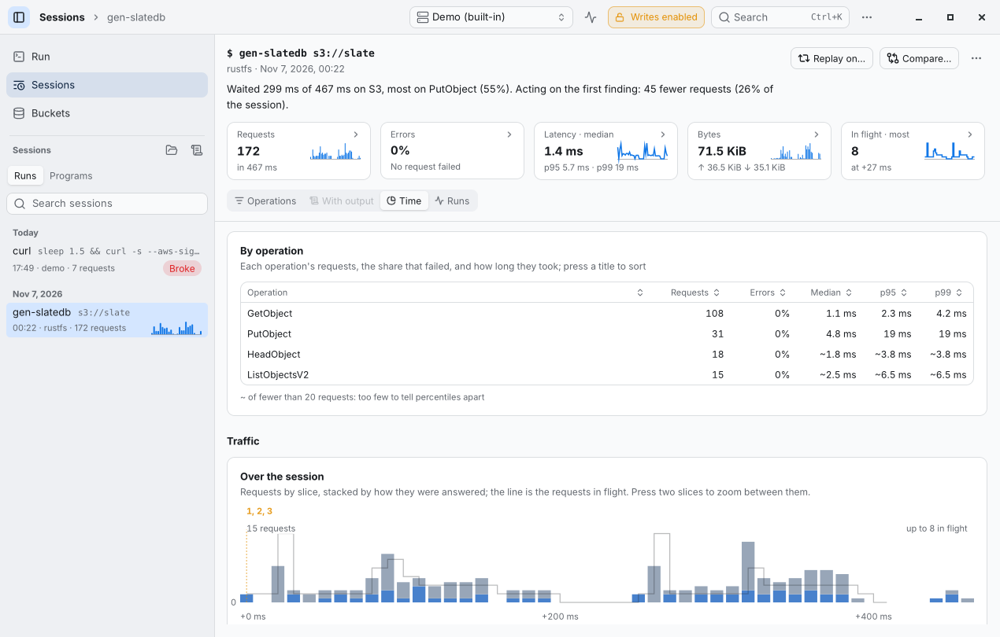
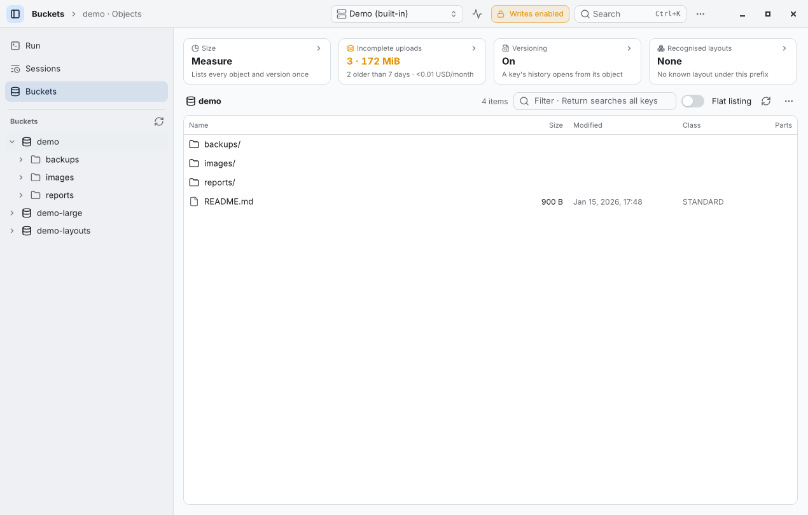

# sonde

**See what your software does to S3.** sonde records a program's object-storage requests through a local endpoint
and reads them as operations — an Iceberg commit, a SlateDB manifest write, a multipart upload — with what stands
out, what it cost, and whether the program survives when the store misbehaves.



## What it does

| | |
|---|---|
| **Record** | `sonde run -- <command>` records every S3 request the program makes. |
| **Read** | Requests become operations: multipart uploads, retries, listings, the commits of Iceberg, Delta, Hudi, Paimon, SlateDB and Lance. A table per operation (count, errors, p50/p95/p99) and charts over time. |
| **Find and fix** | Hot keys, HEAD before GET, throttling, orphaned files, rename-based commits, requests one after another — each with what fixing it saves, a fix for your SDK and the line that sent it. Run again: each finding reads **fixed** (with the saving measured), **less**, **back** or **new**. |
| **Try under faults** | `--trial` runs the program again while sonde answers 503s, lost answers, cut downloads, clock skew, stale listings… and says whether it **survived**, **degraded** or **broke**, and what to change. `--trial --again` tries only what did not survive. |
| **Gate CI** | `sonde check` fails a job over its budget or past its baseline; the GitHub Action (`hxddh/sonde@v19`) keeps one PR comment with what changed and a link to the report ([ci](docs/ci.md)). |
| **Why slow, why costly** | `show --by prefix\|size\|caller\|sdk` splits the table and says where the slow and costly requests are. |
| **Compare and replay** | `compare` two runs, or a session replayed on another store (`--replay`) to see where answers differ. |
| **Import** | S3 access logs, CloudTrail and HAR files read the same way. |
| **Look at stores** | Browse buckets, find incomplete uploads, run 40 compatibility probes across endpoints, decode table layouts. |

A desktop app (macOS, Linux, Windows), a terminal UI and a CLI, in English and Chinese.

| | |
|---|---|
|  |  |
|  |  |

## Where it helps

- **Building on S3**: what a lake engine or SDK really sends, and why it is slow or costly.
- **Before production**: does the program retry, back off and finish its commits when the store fails?
- **In CI**: catch a change that doubles requests or latency before it ships.
- **Choosing a store**: how MinIO, Ceph, R2 or OSS differ from AWS for your traffic.
- **After an incident**: read production access logs as operations.

## How it works

```
program ──(AWS_ENDPOINT_URL, a key of sonde's)──▶ sonde on 127.0.0.1 ──(your real credentials)──▶ S3
                                                        │
                                                        └─▶ session file (.sonde): one line per request
```

- sonde starts an endpoint on loopback and runs the program with `AWS_ENDPOINT_URL` and a key made for that run.
  It checks the program's signature, signs again with your real credentials and forwards the request. The real
  credentials never reach the program.
- A session keeps each request's method, key, headers, status, timing and size — never object data.
- Analysis is in Rust and reads a session as a stream. In a trial, sonde answers chosen requests itself.
- **Depends on**: nothing at run time (one static binary). The program needs an S3 SDK that honours
  `AWS_ENDPOINT_URL` (current AWS SDKs do; Spark and Flink are configured by sonde). The app is built on
  [Native Shell](https://github.com/longbridge/nsh).

More: [architecture](docs/architecture.md), [security](docs/security.md).

## Install

```sh
curl -fsSL https://raw.githubusercontent.com/hxddh/sonde/main/install.sh | sh   # Linux, macOS
```

Or download from [Releases](https://github.com/hxddh/sonde/releases): terminal binaries for Linux, macOS and
Windows; the app as `.dmg`, a Linux tarball (GTK 4) and a Windows zip. Checksums in `SHA256SUMS`.

## Use

```sh
sonde run --demo                        # a tour on a built-in store, no account needed
sonde run --demo -- python etl.py       # your program on the built-in store, no account needed
sonde endpoints import                  # your ~/.aws/config profiles
sonde run -- python etl.py              # record
sonde show                              # read the newest session
sonde run -- python etl.py              # after a change: what is fixed, and what it saved
sonde show --by prefix                  # where the slow requests are
sonde run --trial -- python etl.py 's3://scratch/{trial}/'   # the same under faults
sonde run --trial --again -- python etl.py 's3://scratch/{trial}/'   # after a fix: only what broke
sonde check --init && sonde check       # a budget for CI
sonde compare before.sonde after.sonde
sonde import access.log
sonde share --html --redact -o run.html # one page, names replaced, safe to send
sonde tui                               # the terminal UI
```

Every command, its formats and exit codes: [docs/cli.md](docs/cli.md).

## Good to know

- **What a recorded program may do**: by default `no-delete` — no deletes, no overwriting objects it did not write,
  no bucket policy or versioning changes. `--policy allow` lifts it, `--policy read-only` allows only reads
  ([recording](docs/recording.md)). On a store that ignores `If-None-Match`, use `--policy read-only`. A safety net,
  not a sandbox: the program runs with your rights ([security](docs/security.md#run)).
- **A trial runs the program again**, once per scenario: point it at scratch paths with `{trial}` in a key, or
  every run writes over the last ([trials](docs/trials.md)).
- sonde's own destructive actions (aborting uploads, deleting versions) are each a dry run and a typed
  confirmation, and are written to an audit log.
- Not supported yet: S3 Express One Zone (refused with a reason), SigV4a, HTTP/2 to the endpoint.
- Memory grows with a session's requests: about a million in 2 GB ([performance](docs/performance.md)).
- No telemetry. Credentials stay in sonde; logs and shared pages can be redacted.
- What is stable between versions — session files, JSON outputs, `sonde.toml`, flags, exit codes — is in
  [docs/contract.md](docs/contract.md).

## Documentation

[CLI](docs/cli.md) · [CI](docs/ci.md) · [Recording](docs/recording.md) · [Trials](docs/trials.md) · [Configuration](docs/configuration.md) ·
[Credentials](docs/credentials.md) · [Security](docs/security.md) · [Contract](docs/contract.md) ·
[Session format](docs/session-format.md) · [Probes](docs/probes.md) · [Decoders](docs/decoders.md) ·
[Performance](docs/performance.md) · [Architecture](docs/architecture.md) · [Decisions](docs/decisions.md) ·
[Packaging](docs/packaging.md) · [Changelog](CHANGELOG.md)

## Develop

```sh
cargo test --workspace          # Rust 1.95+; the app and `sonde tui` need 1.97
scripts/ui-tests.sh             # the app's UI tests, headless (needs the nsh CLI)
scripts/integration.sh          # against Ceph RGW and RustFS in Docker
```

Apache-2.0.
