# 2.1 and 3.0, side by side

The same states of the app in 2.1.0 (left) and 3.0.0 (right), from `scripts/shots.sh` on a GTK window at 1280×820.
What changed, and why, is in the [changelog](../CHANGELOG.md) and decisions D-040 to D-045 in
[decisions.md](decisions.md).

## Run

The sidebar has three places; Settings and Activity left it (Activity is the pulse icon in the toolbar). The end of a
run is said once, in the band above the operations.

| 2.1 | 3.0 |
|---|---|
| 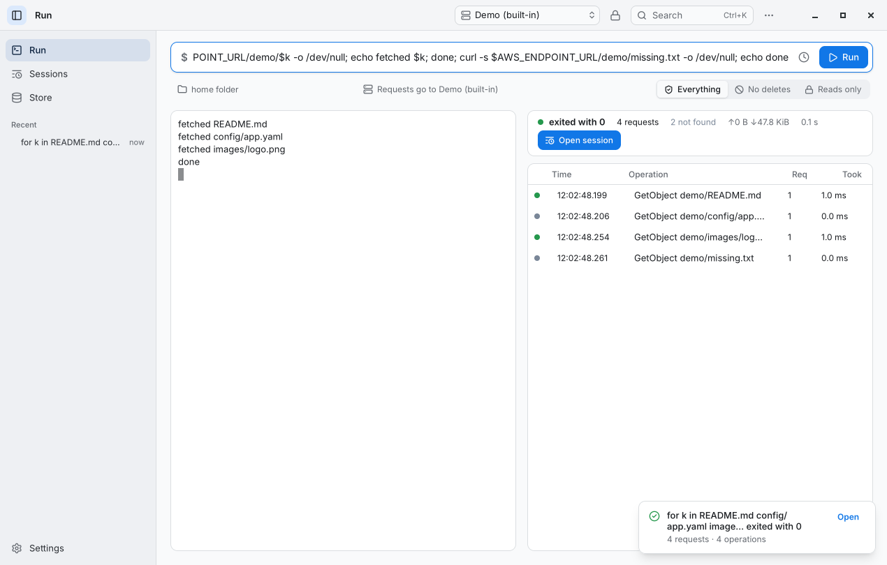 | 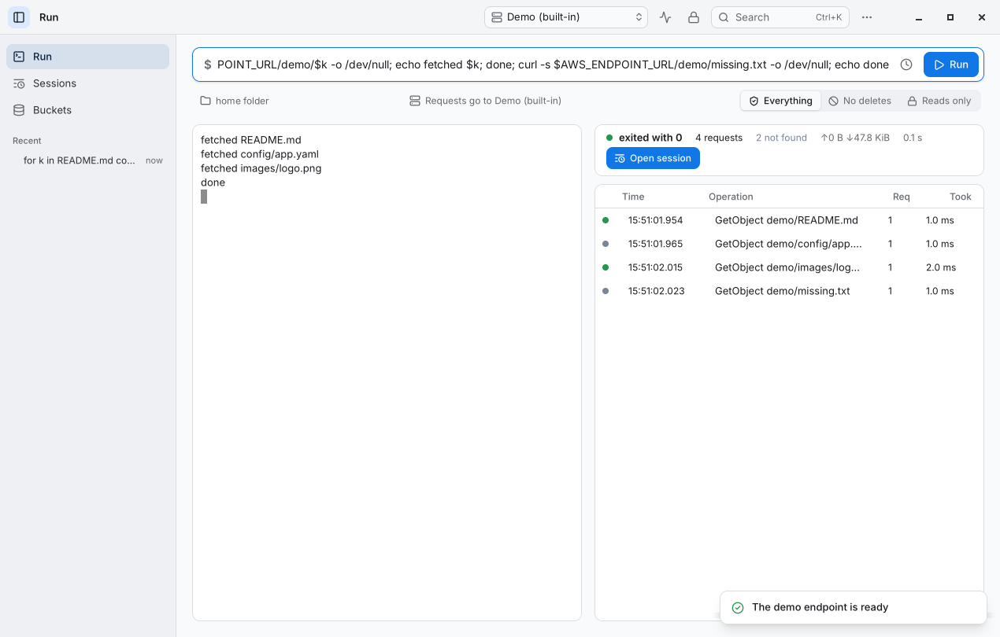 |

## A session

The same SlateDB recording. Operation titles and observations come from phrases, so the Chinese window says them in
Chinese; resting on an observation explains it.

| 2.1 | 3.0 |
|---|---|
| 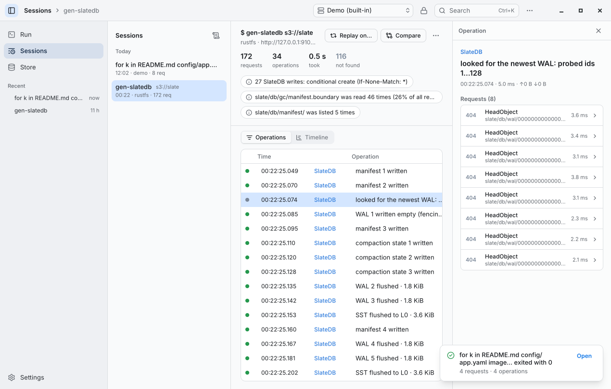 |  |
| 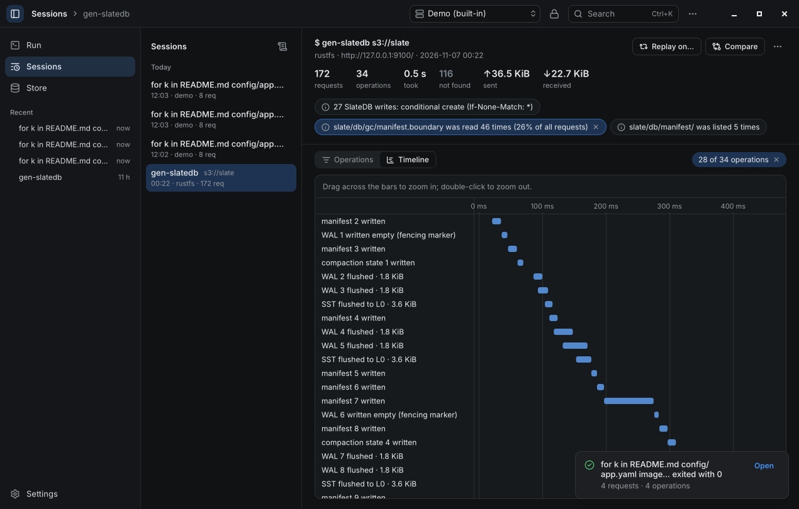 | 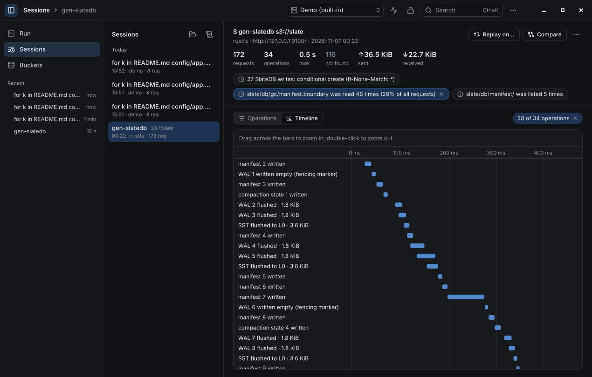 |
| | 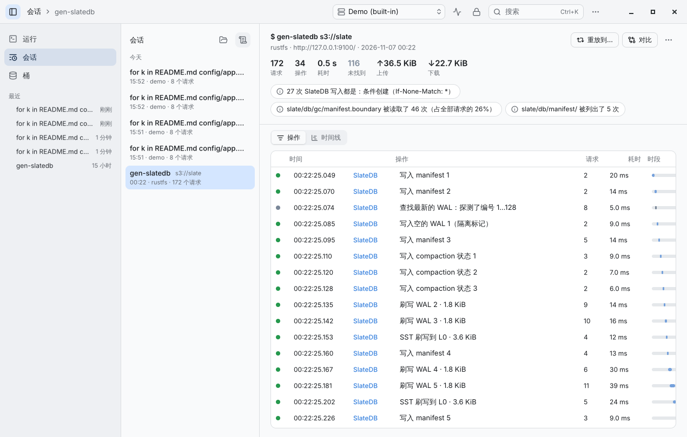 |

## Buckets

2.1 had six tabs over a bucket, five of them a prefix field and a Scan button. 3.0 has none: the overview says what
sonde found as the bucket opens, and each card opens its detail in a sheet.

| 2.1 | 3.0 |
|---|---|
| 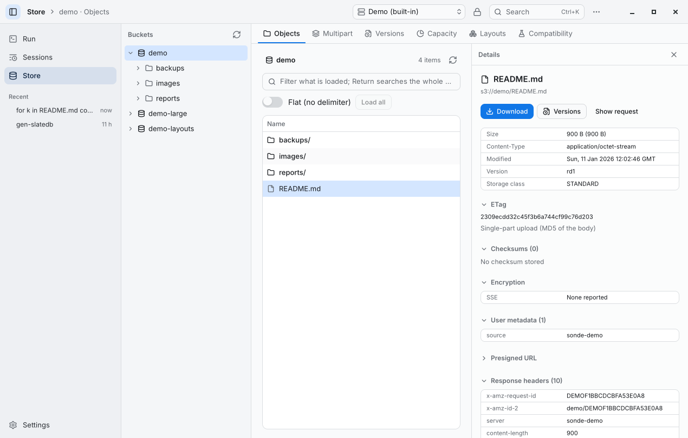 | 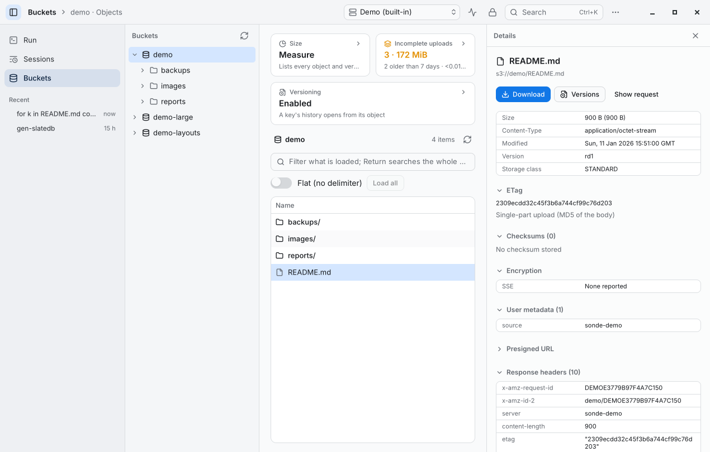 |
| | 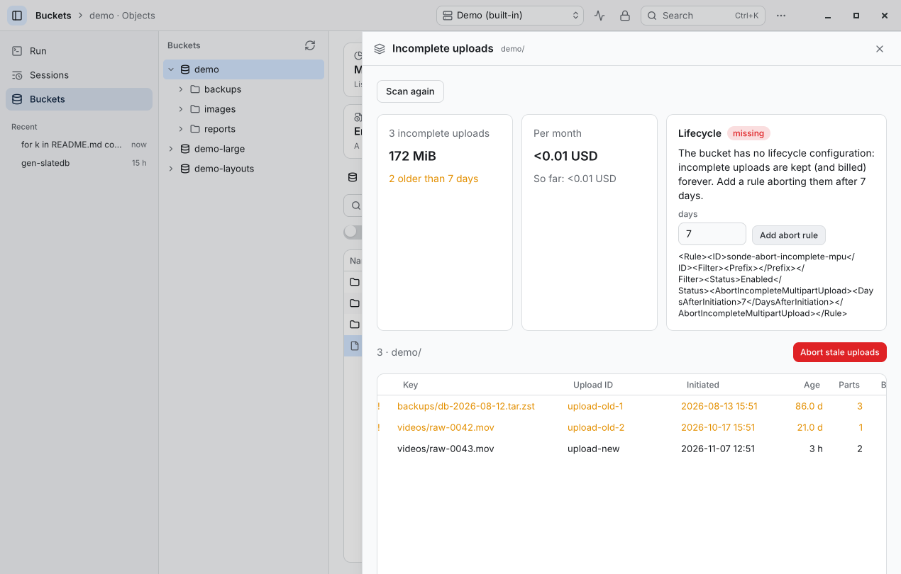 |

## Settings, compatibility, the palette

| 2.1 | 3.0 |
|---|---|
| 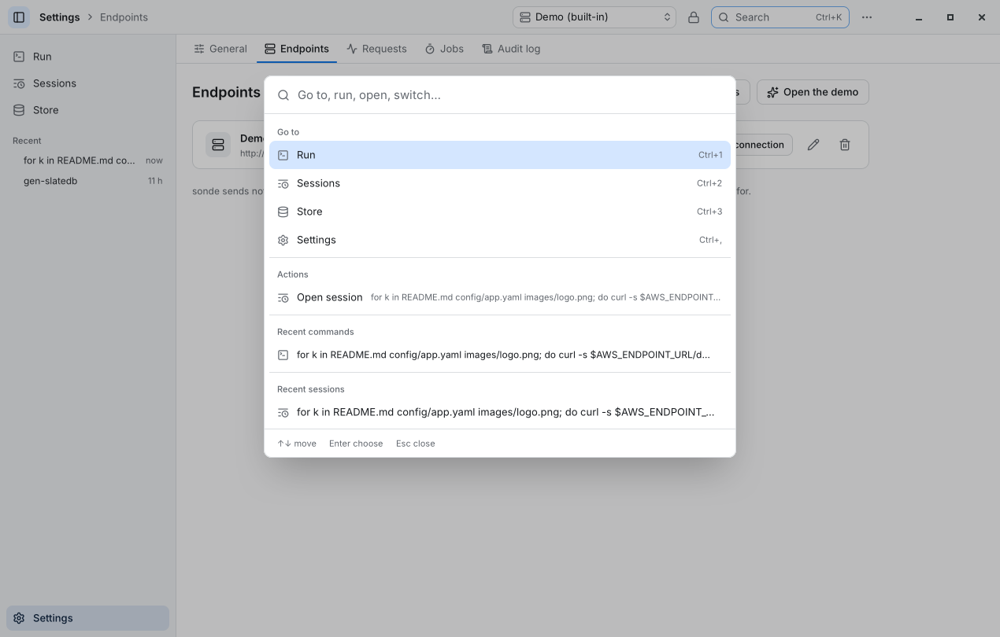 | 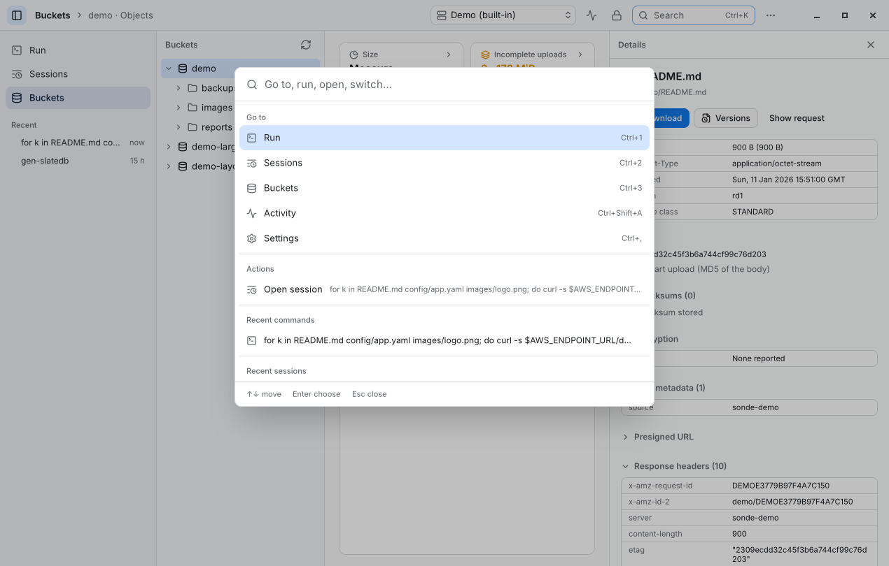 |
| | 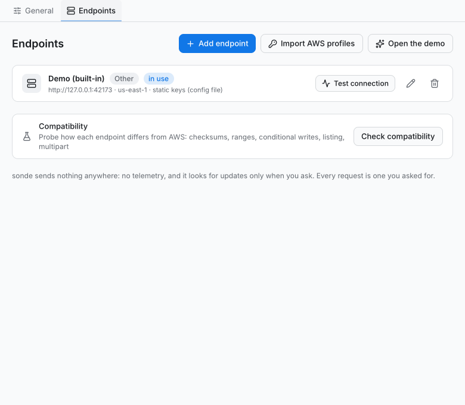 |
