# 3.0 and 4.0, side by side

The same states of the app in 3.0.0 (left) and 4.0.0 (right), from `scripts/shots.sh` on a GTK window at 1280×820
(the last row at the least window size, 900×560). What changed, and why, is in the [changelog](../CHANGELOG.md),
decisions D-046 to D-050 in [decisions.md](decisions.md), and the standards in [app/DESIGN.md](../app/DESIGN.md).

## A session

3.0 showed what stands out as chips, its explanation behind a hover. 4.0 gives it the room of the session's core
result: each finding, why it matters, and the operations it narrows to, in place. In a short window the findings
scroll inside a quarter of its height, so the operations keep theirs.

| 3.0 | 4.0 |
|---|---|
| 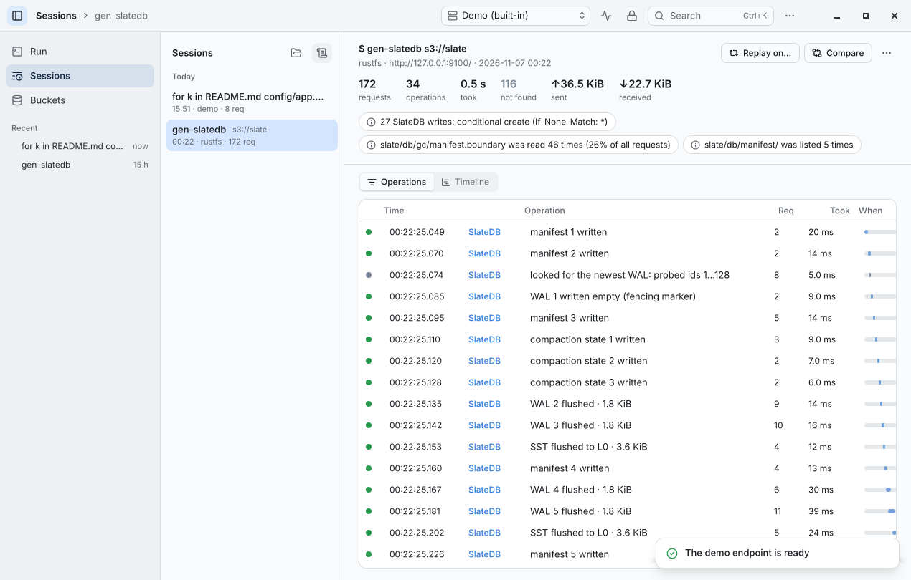 |  |
| 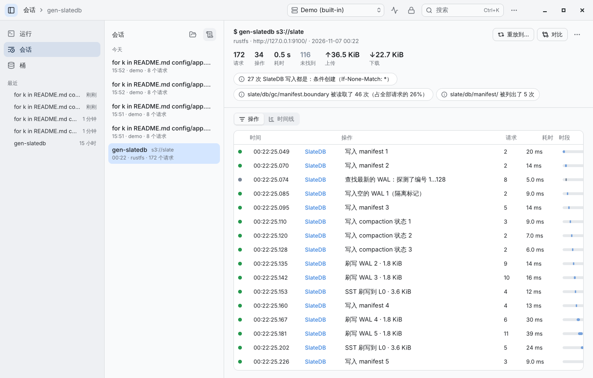 | 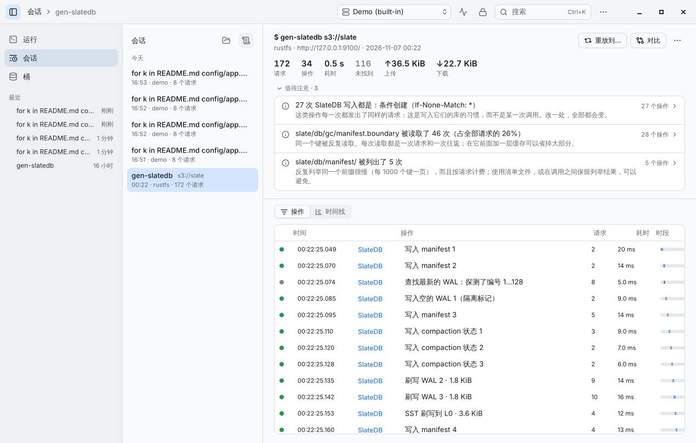 |
| | 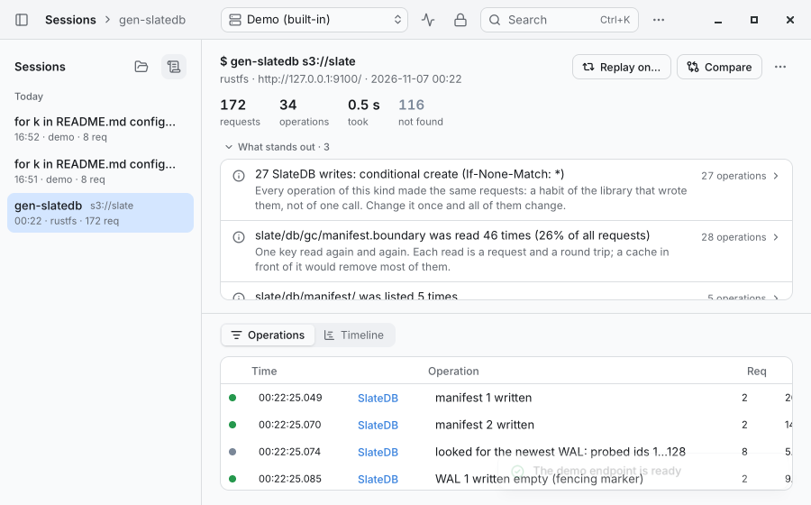 |

## Run, Buckets, Settings

One type scale, one popup surface, one side panel with one header and scrim; primary buttons only where Return
commits; commands that open more end with "…".

| 3.0 | 4.0 |
|---|---|
| 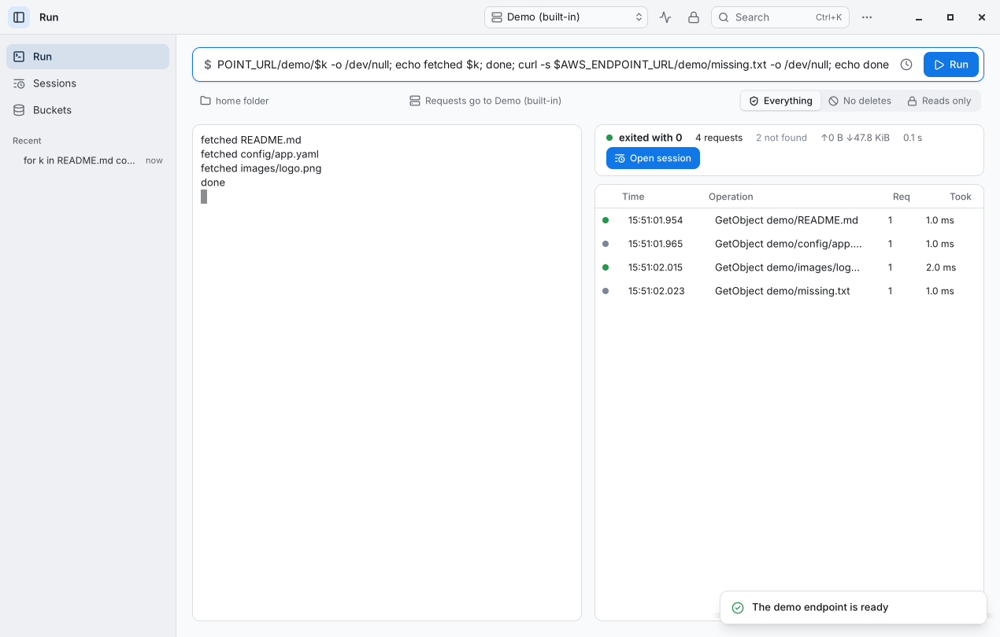 | 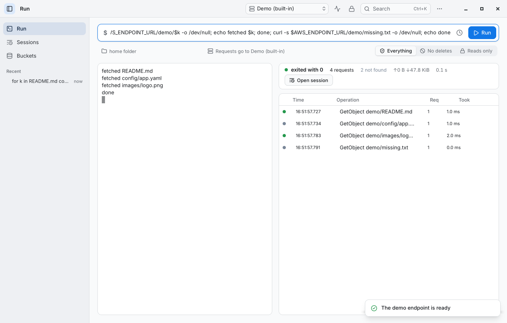 |
| 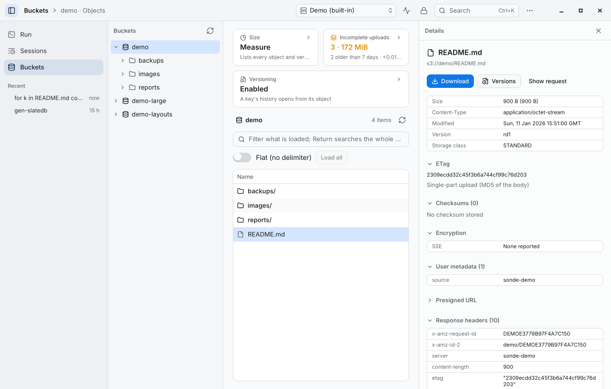 | 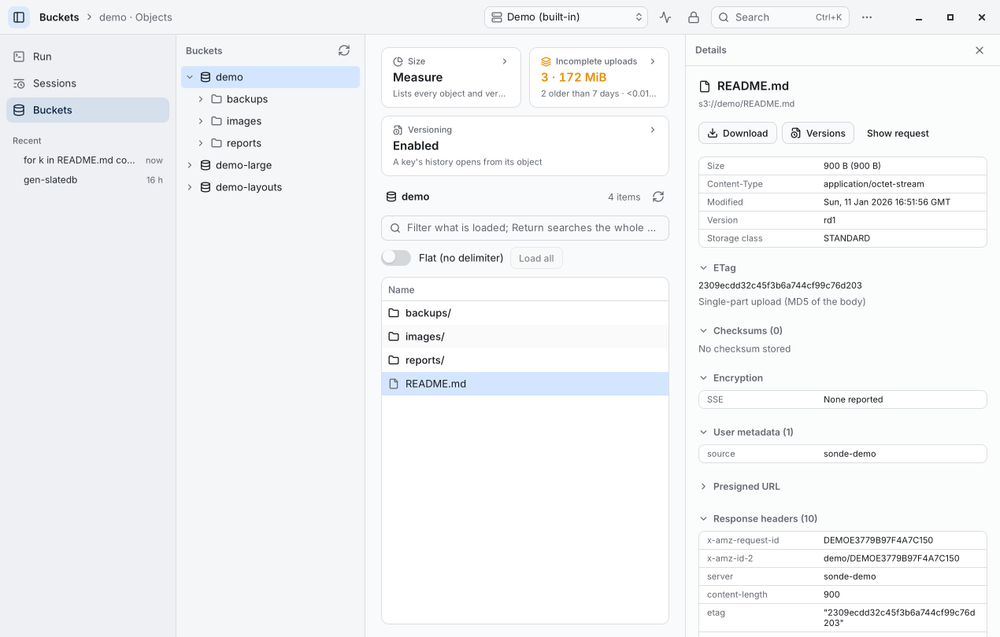 |
| 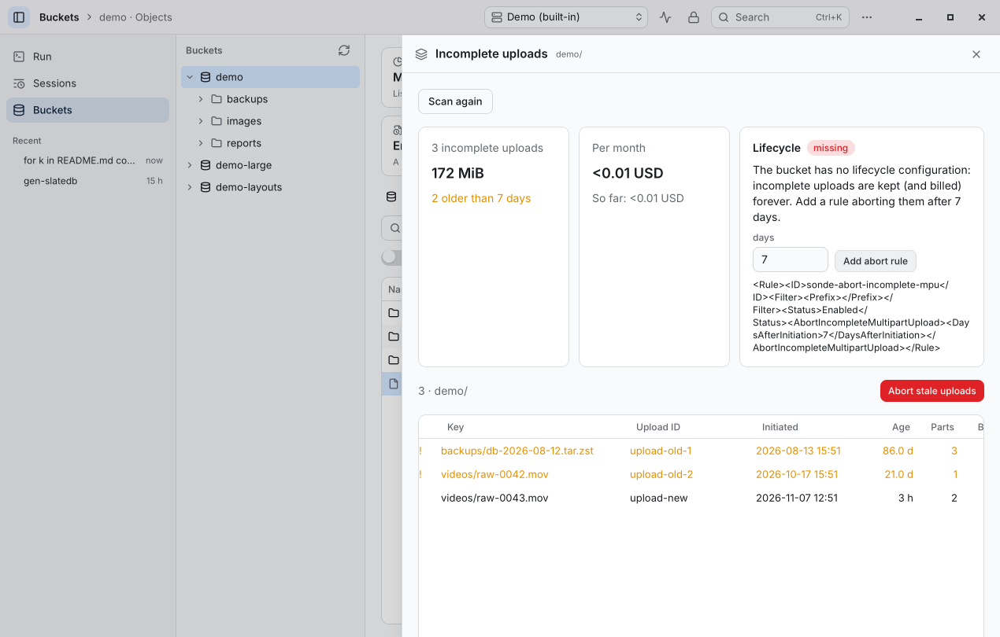 | 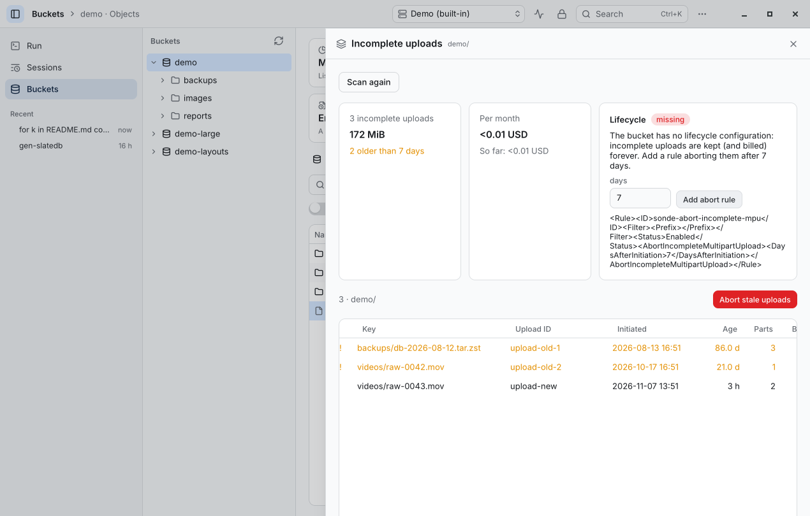 |
| 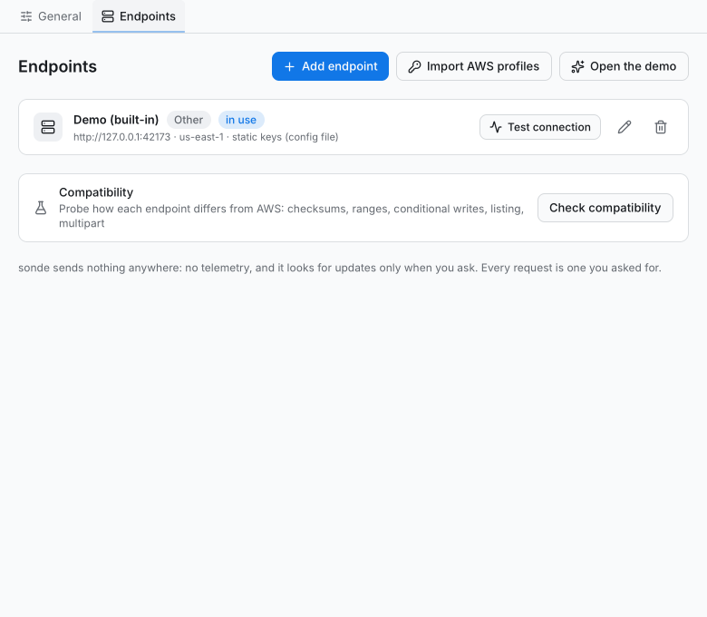 | 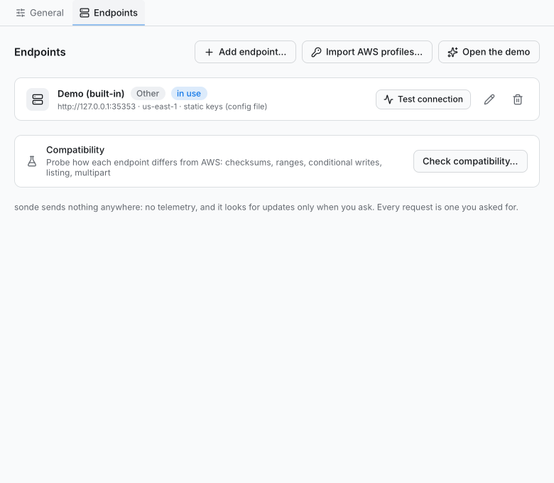 |
| | 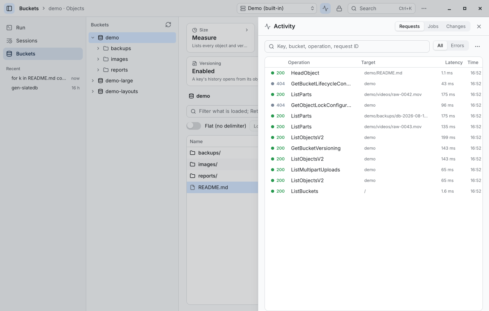 |

## What a screenshot does not show

- On macOS the sidebar sits on the window's own sidebar material, floating surfaces on Liquid Glass (macOS 26) or a
  blur, and session windows gather as tabs with their file in the title bar.
- A program or a job at work shows on the Dock's icon and the taskbar button.
- Splits are remembered; table rows grow with the user's text size; a failing view says so and can try again.
