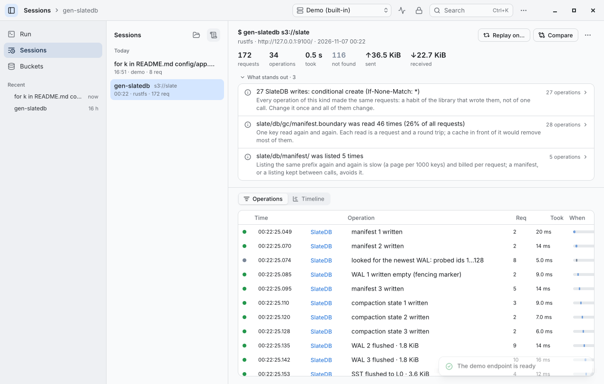
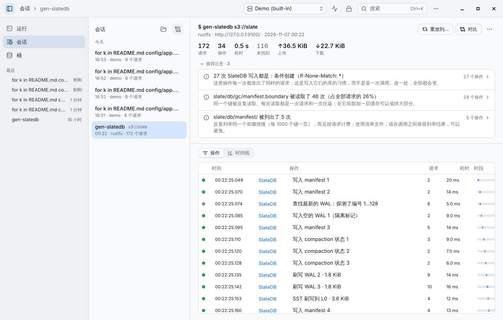
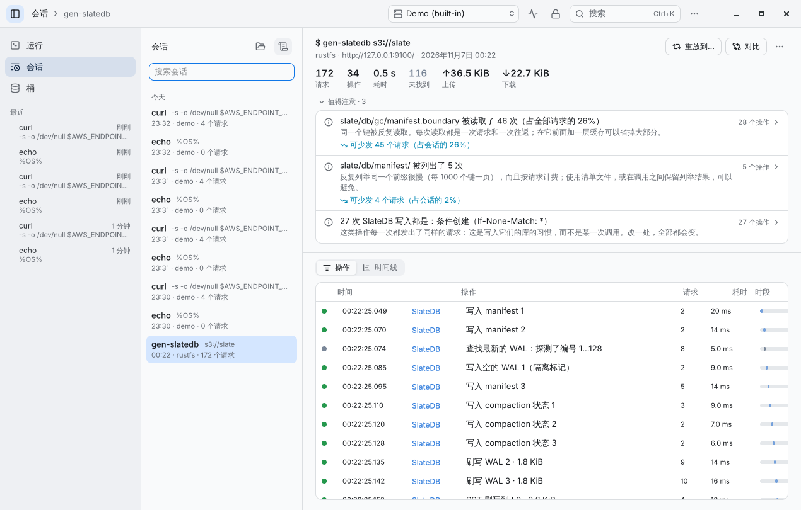
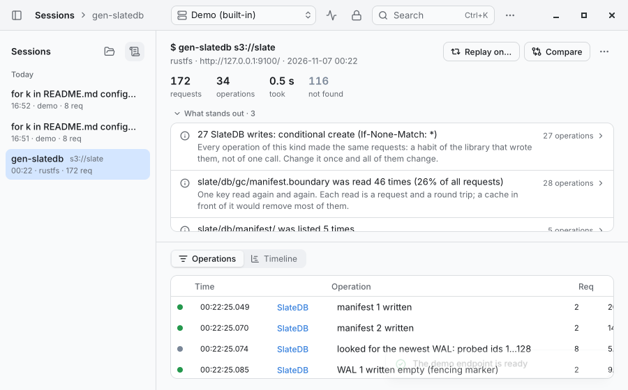
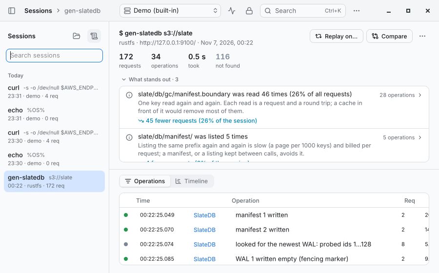
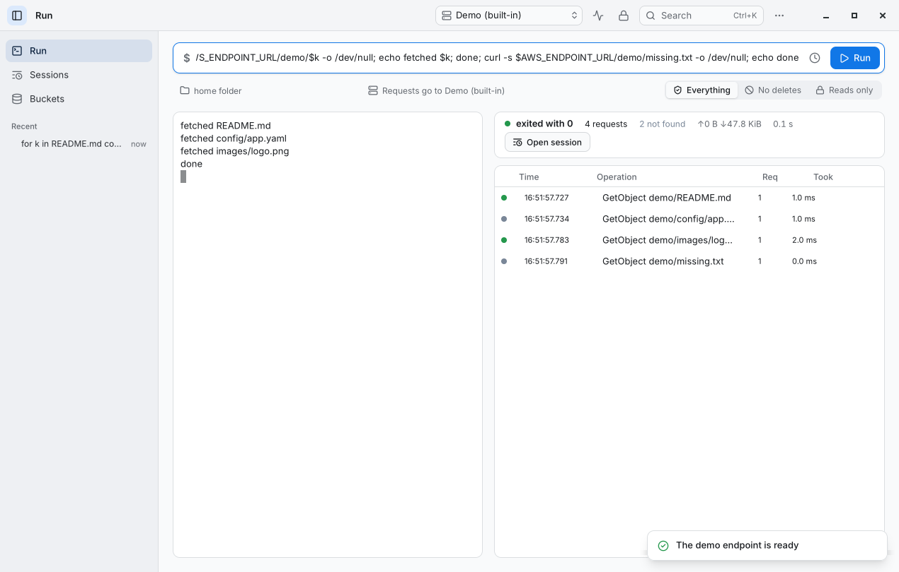
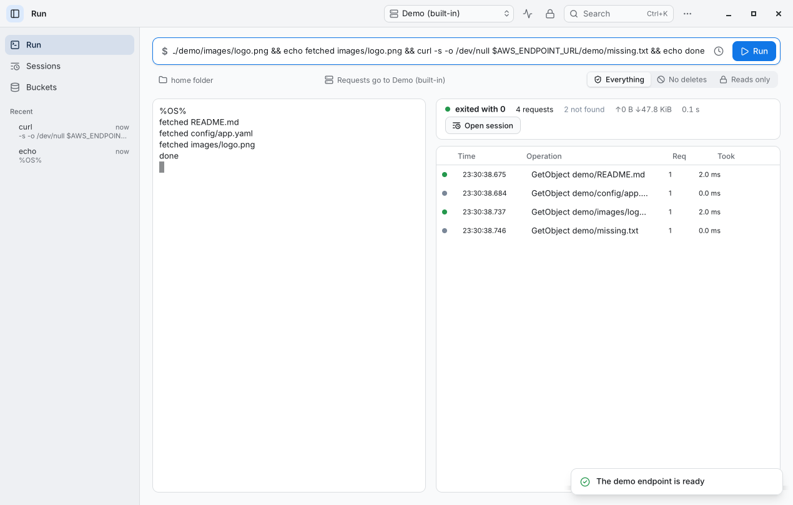
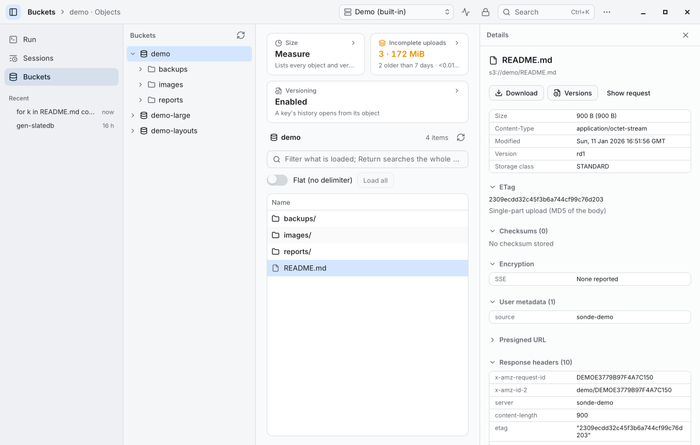
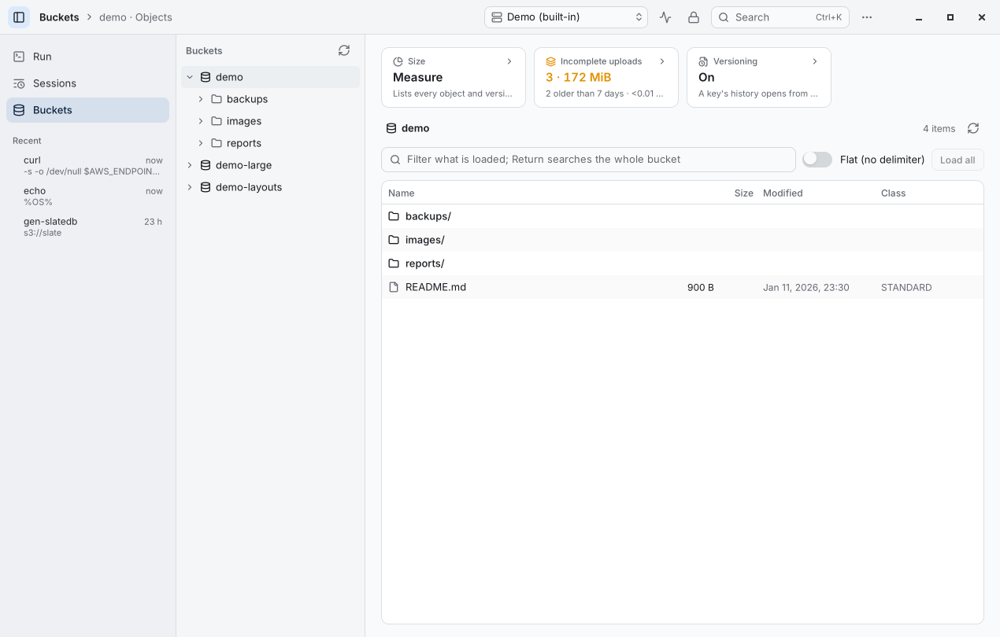

# 4.0 and 5.0, side by side

The same states of the app in 4.0.0 (left) and 5.0.0 (right), from `scripts/shots.sh` on a GTK window at 1280×820
(the session at the least window size, 900×560, too). What changed, and why, is in the [changelog](../CHANGELOG.md)
and decisions D-051 to D-055 in [decisions.md](decisions.md).

## A session

Findings come ranked — warnings first, then by the requests they bear on — and say what acting on them saves. The
session list keeps its days in view and, with a few sessions, has a search field; each session's context menu
renames, shares and deletes it. Dates are written as the reader's language and clock write them.

| 4.0 | 5.0 |
|---|---|
|  |  |
|  |  |
|  |  |

## Run, Buckets

The sidebar's recent sessions have a second line, so two runs of one program differ; the overview's cards share
their row in equal columns.

| 4.0 | 5.0 |
|---|---|
|  |  |
|  |  |

## What a screenshot does not show

- A large session opens without stopping the window: it is read in the background, its outline shown meanwhile,
  and read once per version of its file.
- A `.sonde` file dropped on the window opens; File › Open Recent lists the newest sessions.
- Share opens the session as a web page in the browser; the folder it was written to is one copy away.
- Polls rest while the window is out of sight; a closed side panel returns a screen reader to what opened it.
