# 5.0 and 6.0, side by side

The same states of the app in 5.0.0 (left) and 6.0.0 (right), from `scripts/shots.sh` on a GTK window at 1280×820
(the session also at the least window size, 900×560). What changed, and why, is in the [changelog](../CHANGELOG.md)
and decisions D-056 to D-060 in [decisions.md](decisions.md); the rules the charts follow are in
[app/DESIGN.md](../app/DESIGN.md#charts).

## A session

Beside its figures, the session's shape: requests by outcome over time and requests in flight. A press on a slice
narrows the operations, and the timeline, to that moment.

| 5.0 | 6.0 |
|---|---|
| 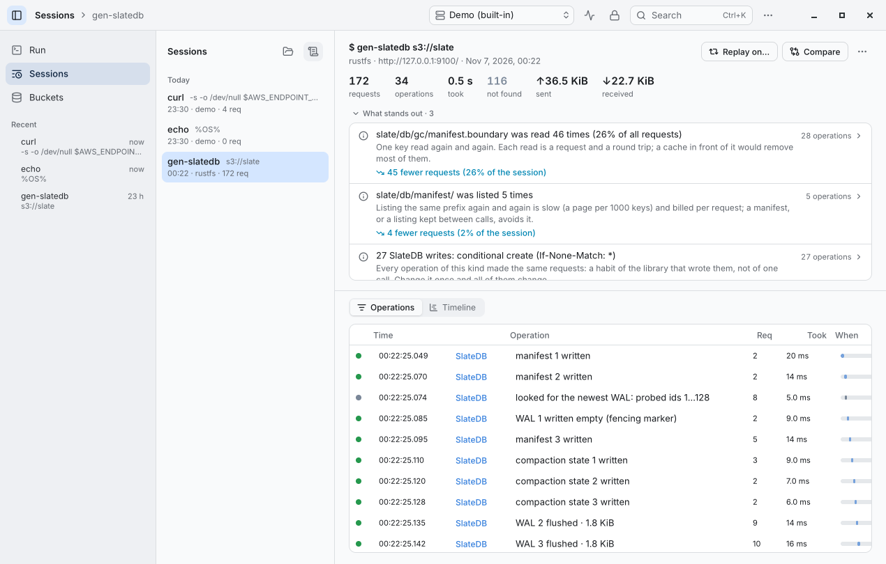 |  |
| 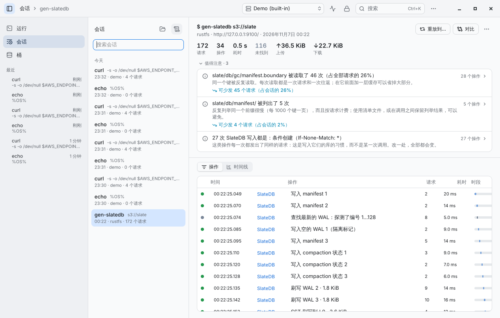 | 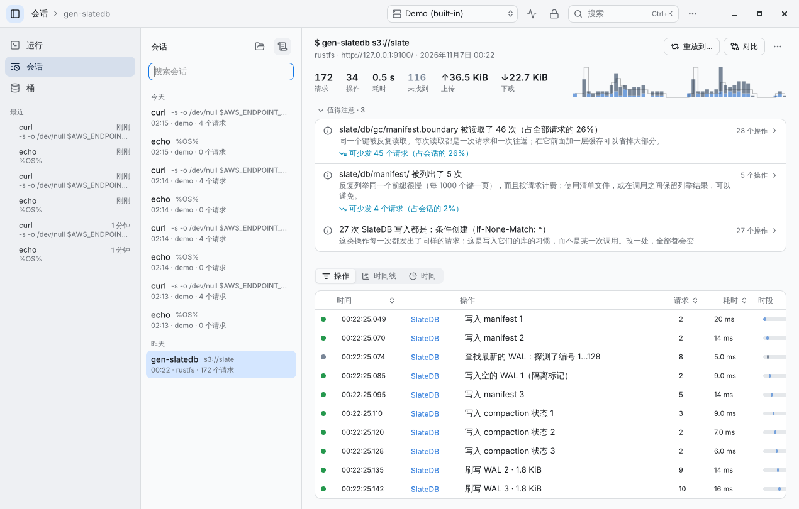 |
| 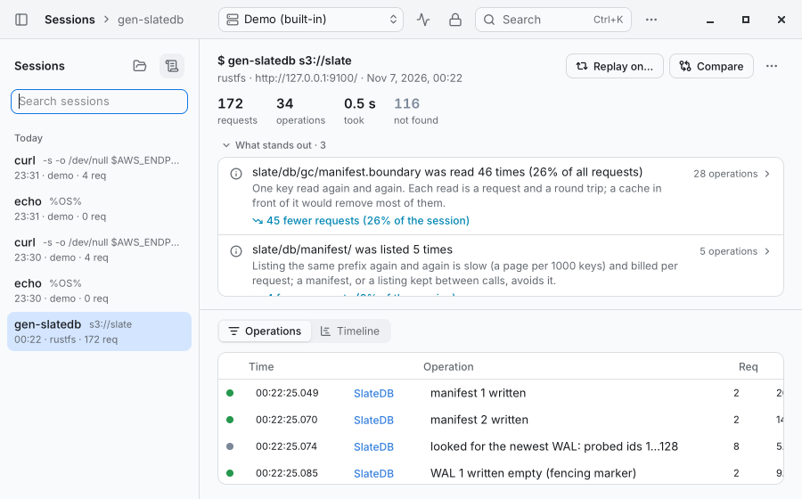 | 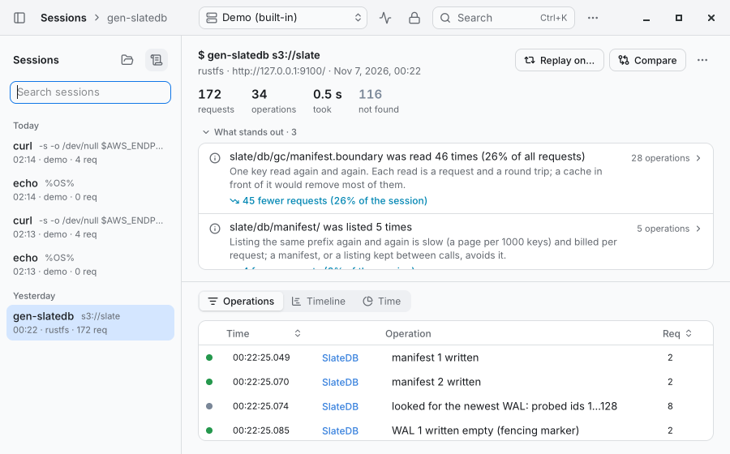 |
| 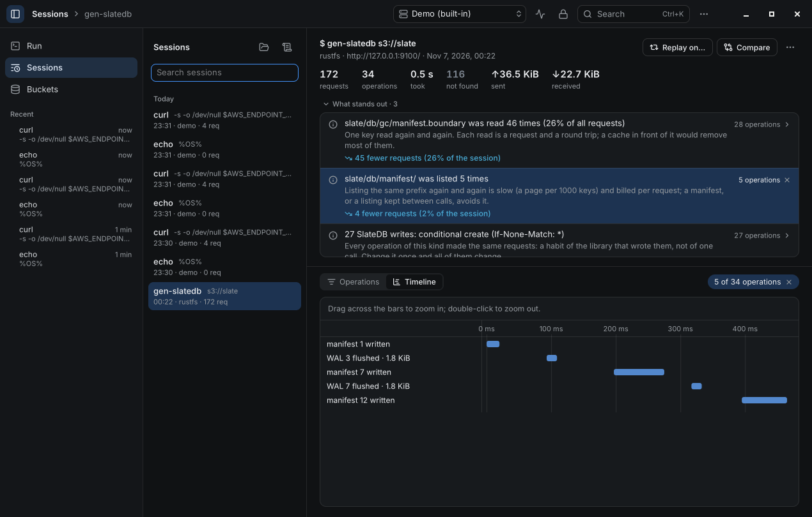 | 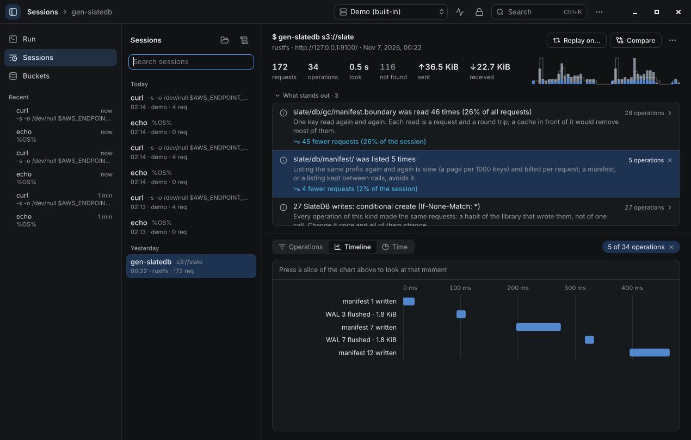 |

## New in 6.0

| | |
|---|---|
| 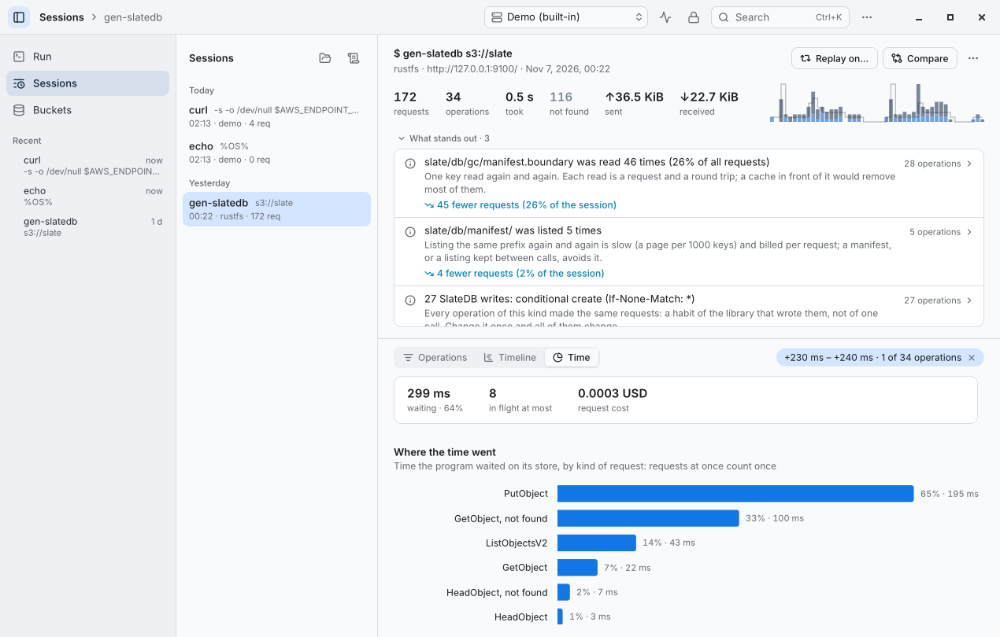 | 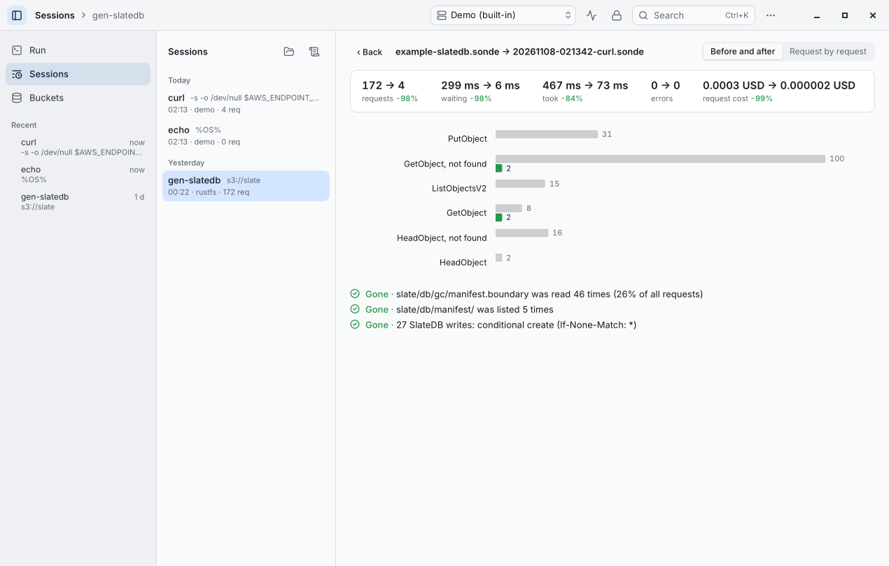 |
| 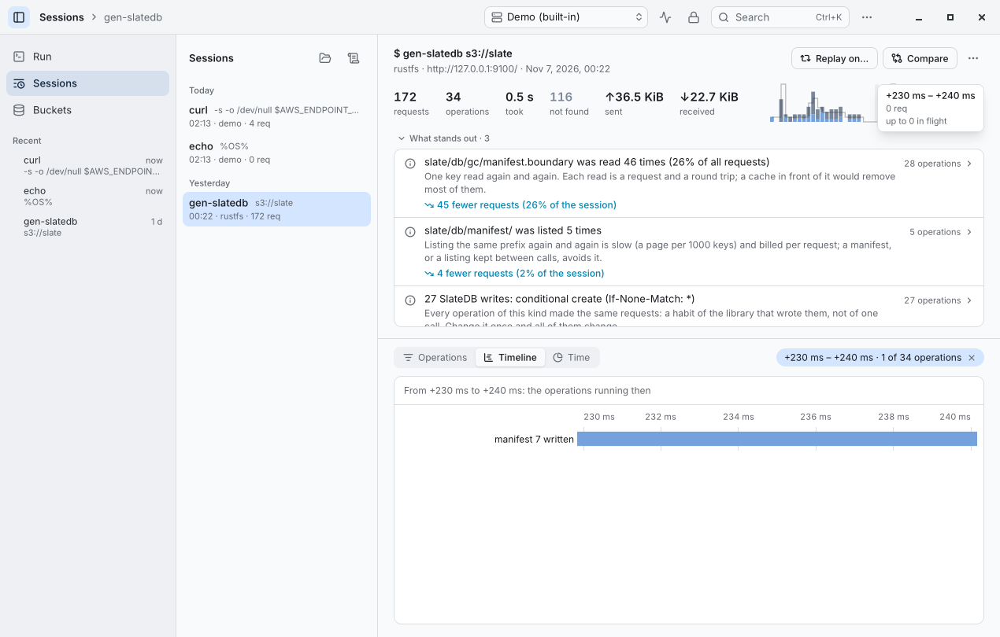 | 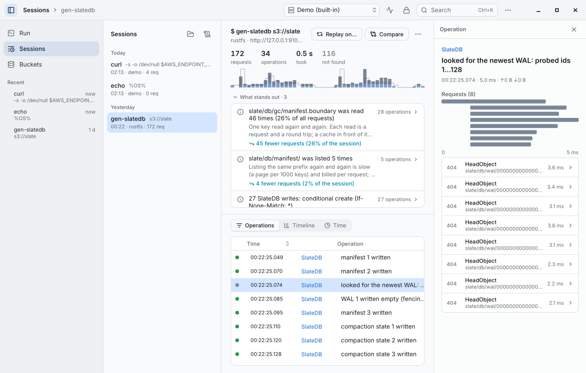 |

## What a screenshot does not show

- The pointer over a chart shows its row in a card beside it, the rest of the chart fading back; the keyboard steps
  through the rows, and a screen reader hears what the chart shows and what stands out.
- Under Run, the shape grows as the program's requests arrive.
- `sonde show` prints where the time went; `sonde compare before.sonde after.sonde` prints what a change did.
