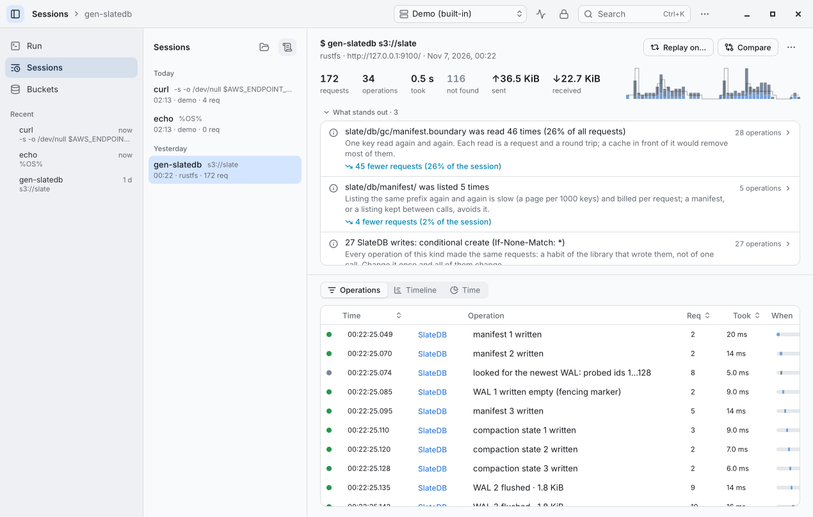
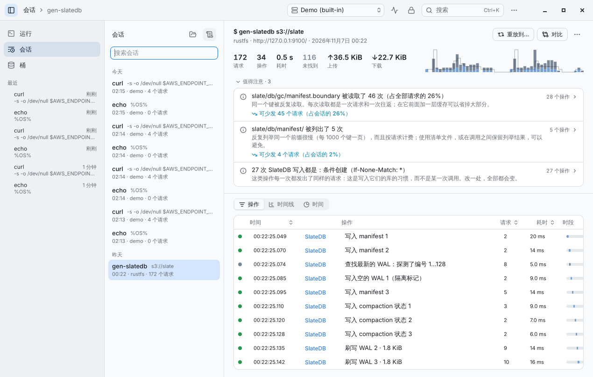
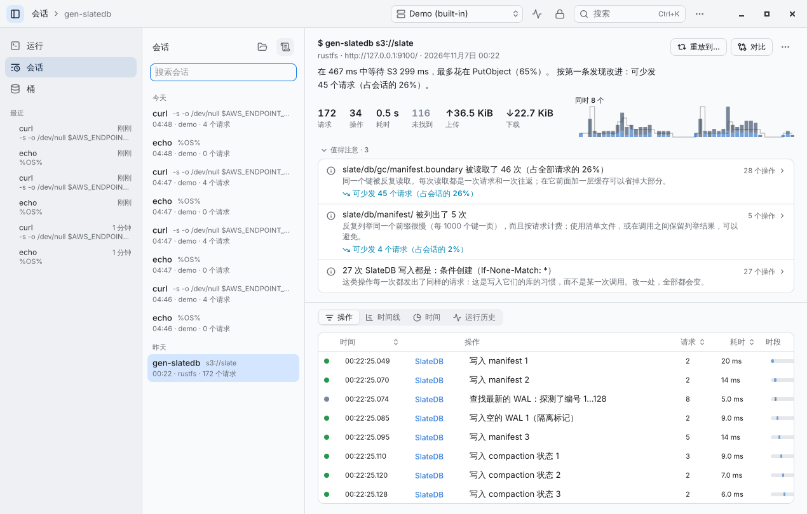
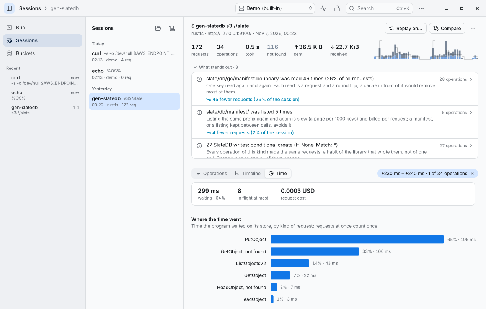
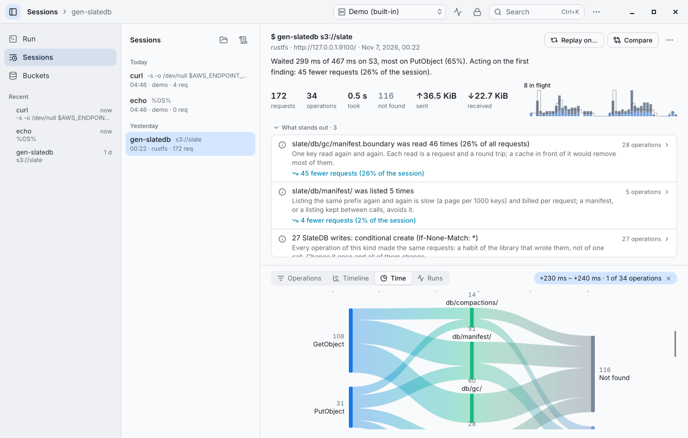
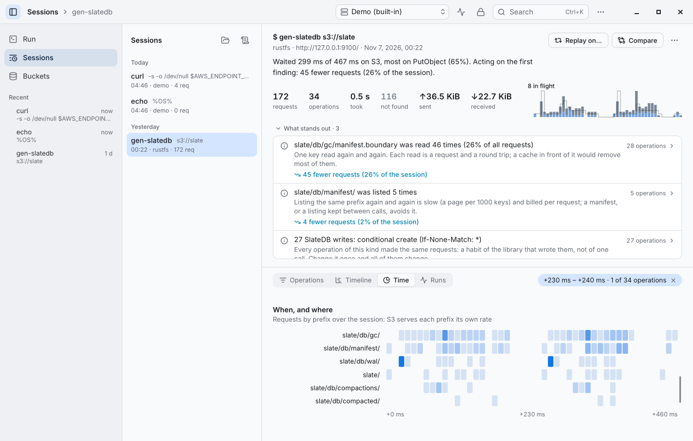
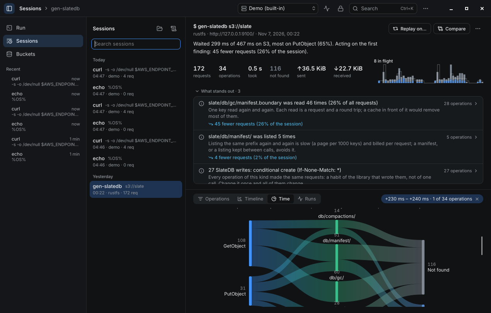

# 6.0 and 7.0, side by side

The same states of the app in 6.0.0 (left) and 7.0.0 (right), from `scripts/shots.sh` on a GTK window at 1280×820.
What changed, and why, is in the [changelog](../CHANGELOG.md) and decisions D-061 to D-065 in
[decisions.md](decisions.md); the rules the charts follow are in [app/DESIGN.md](../app/DESIGN.md#charts).

## A session

The session says in a sentence where its time went and what acting on its first finding saves; its shape names its
busiest moment; resting on a figure shows what it is made of.

| 6.0 | 7.0 |
|---|---|
|  |  |
|  |  |

## The Time pane

Where requests went (from each kind of operation to the prefixes it touched to how they were answered), when and
where (requests by prefix over the session), and how long requests took (median to p95, the slowest a ring).

| 6.0 | 7.0 |
|---|---|
|  |  |
| |  |
| |  |

## What a screenshot does not show

- A program's runs: the Runs pane of a session plots each run of its command (requests, waiting, cost, warnings),
  its baseline dashed; a run is checked against the baseline as it opens. `sonde check` does the same in CI and
  exits 1 when a run is over its budget or past its baseline.
- `sonde://` links open a session or a bucket in the app (`sonde show --app`); a pressed run notification opens the
  run; warnings wait on the Dock's icon or the taskbar button.
- A request's document and an error body read as code, the S3 error marked where it stands.
