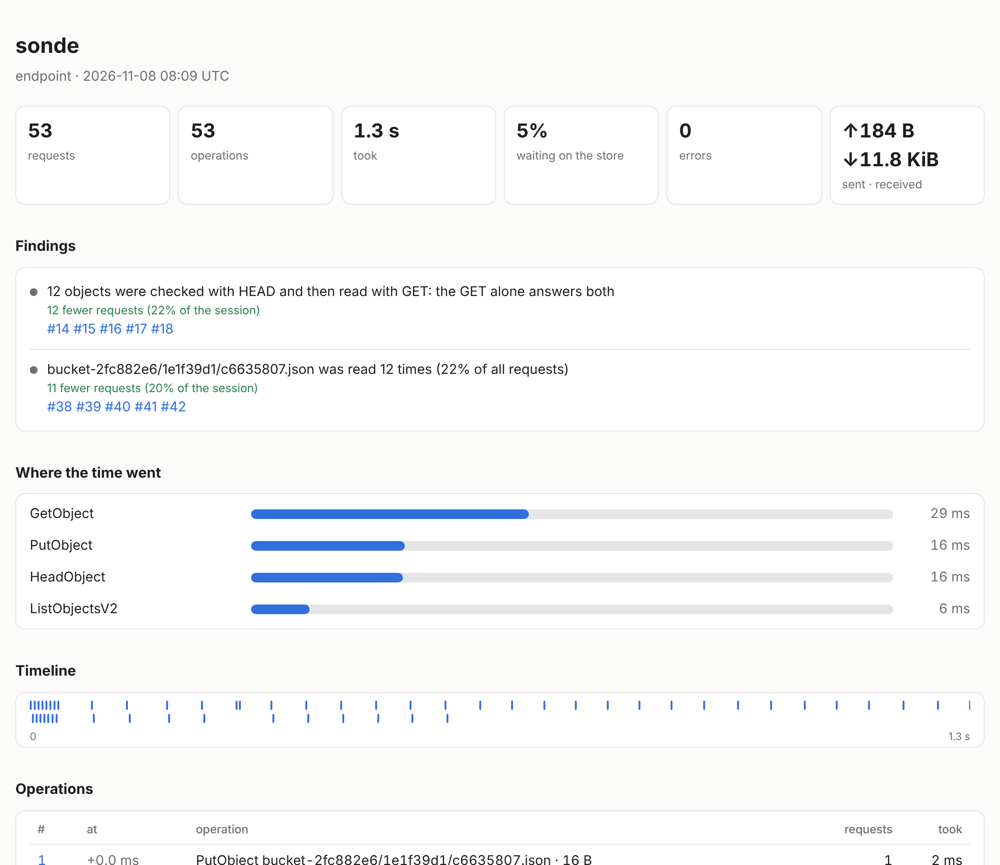
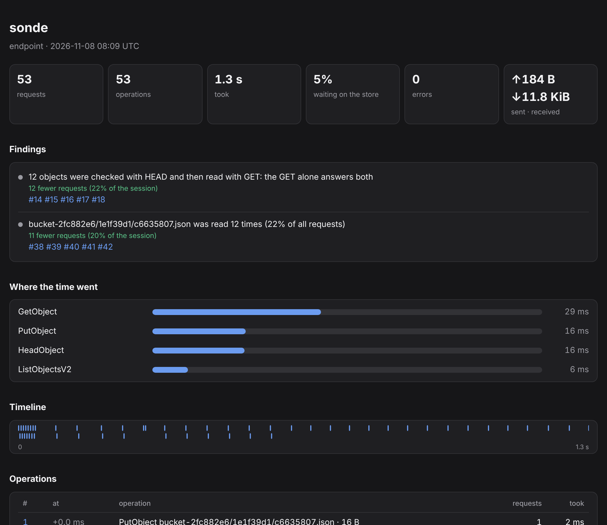

# 8.0: what changed

What 8.0.0 adds over 7.0.0, with the reasons in the [changelog](../CHANGELOG.md).

## A session as one file

`sonde share --html --redact` writes the session as a single page: its figures, its findings (each linking to its
operations), where the time went, a timeline and every operation at its own `#op-N`. Redacted, bucket and key names
are stable tokens, so the findings still read; nothing that names the data leaves.

| Light | Dark |
|---|---|
|  |  |

## What a screenshot does not show

- The recording endpoint serves only the program sonde gave its keys: every request's signature is verified, and
  only a loopback Host is taken (`--allow-remote` opens it).
- Requests that waited on each other: a finding, and in Time each chain as it ran beside the same requests eight at
  once.
- One workload on two stores: a replay's answers open on each kind's p95 on both; `sonde replay` and `sonde diff`
  print the table.
- `sonde demo`, `sonde watch`, `sonde sessions`, `sonde check --baseline auto`, `sonde endpoints add`.
- Sessions are compressed (35× on a million requests) and the app reads a live one in steps
  ([performance](performance.md#a-session-of-a-million-requests-800)).
- Higher contrast, terminal parity (the session's sentence, findings that narrow, sortable columns), and a static
  Linux build.
