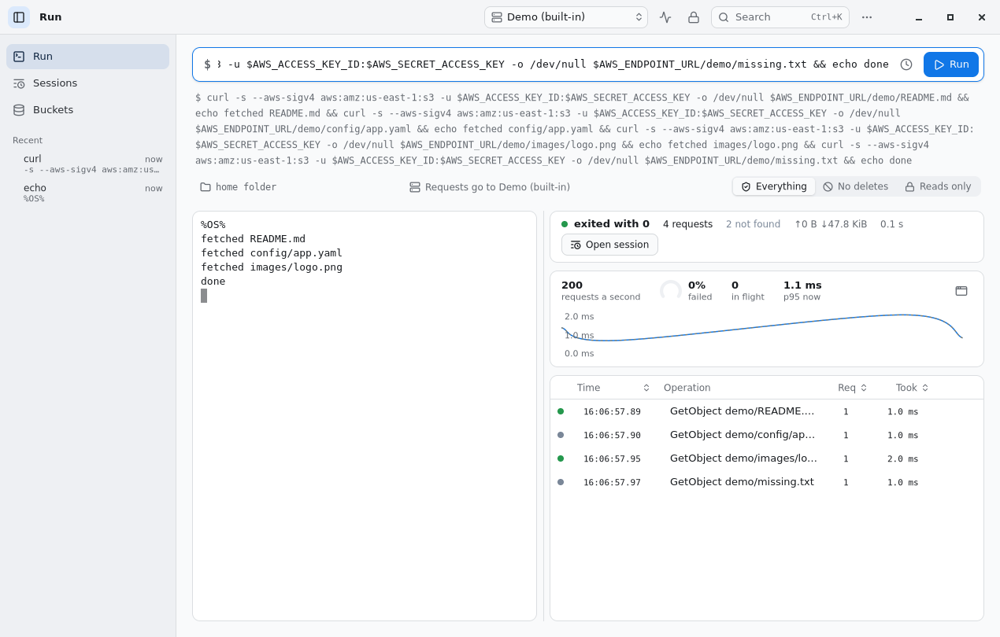
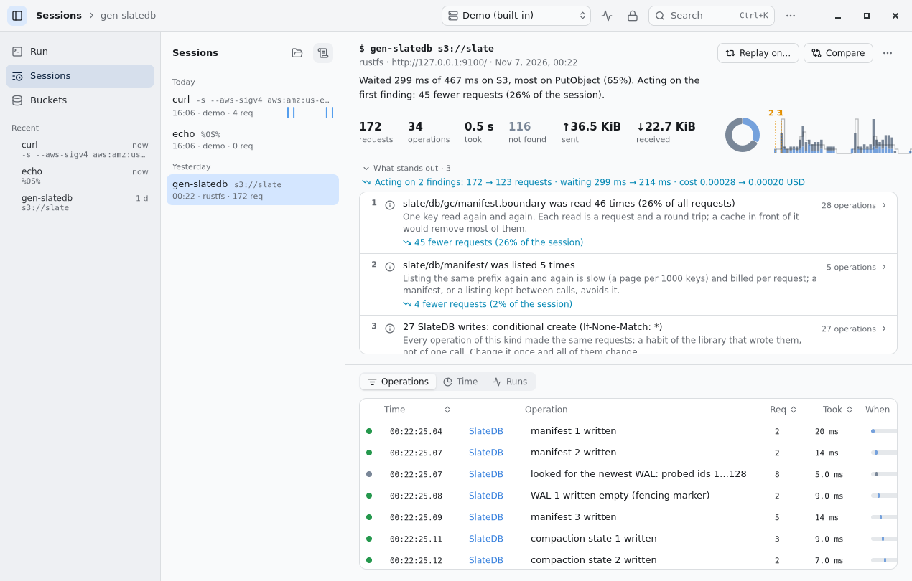
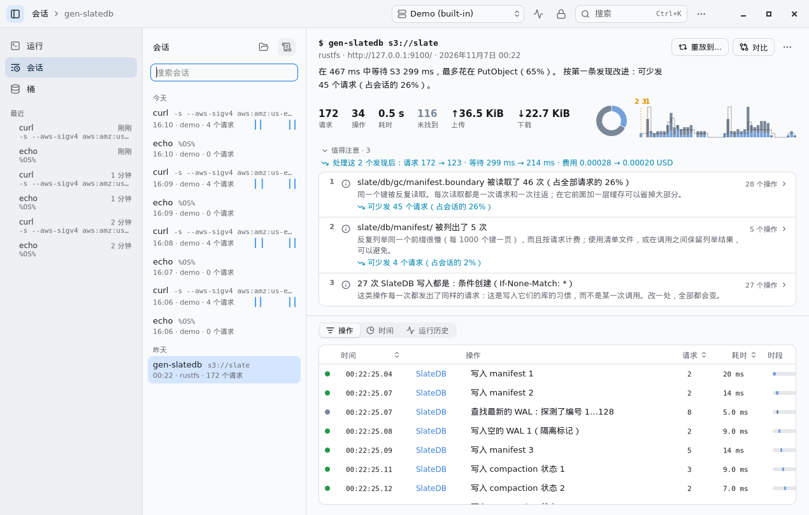
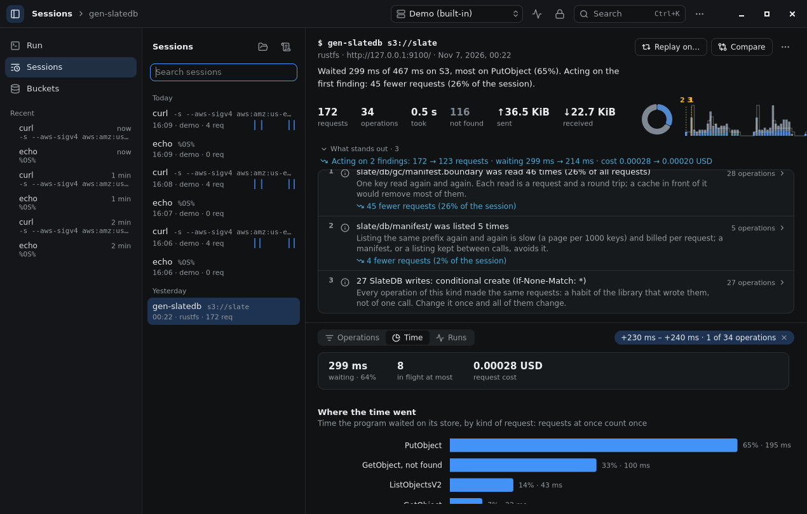
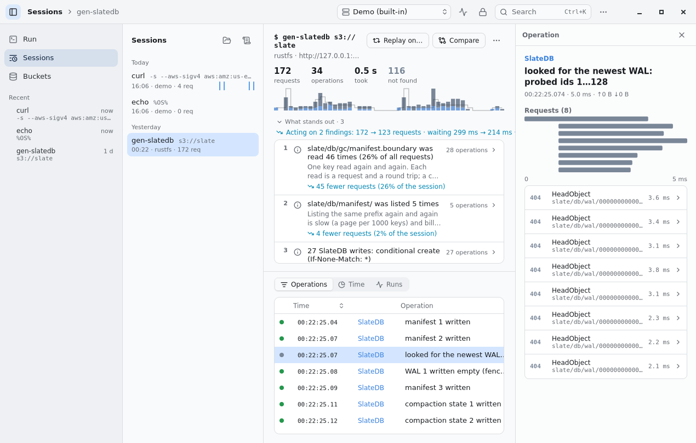
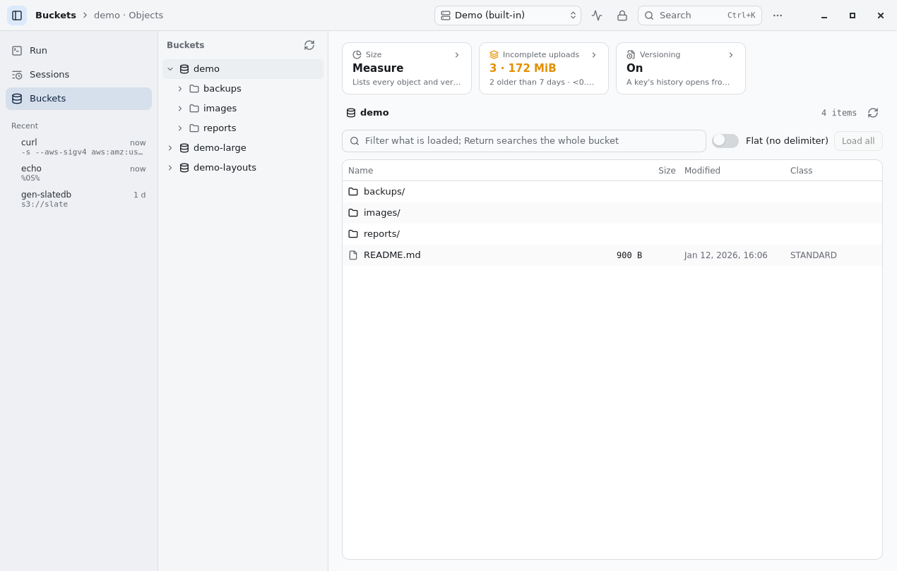

# 9.0: what changed

What 9.0.0 adds over 8.0.0, with the reasons in the [changelog](../CHANGELOG.md). The screens are CI's (Linux,
GTK) on the built-in demo and the example SlateDB session.

## A run, as it goes

Run shows requests a second, the share that failed, in flight now and the p95 while the program runs, and how long
requests take as a band beside the session's shape. A small monitor floats above other windows (from Run or the
tray); ⌘⌥R / Ctrl+Alt+R runs the last command again, or stops it, from any app.

## A session, at a glance

How requests were answered, as a ring; each finding's number over the slice where it begins; what acting on every
finding would leave (requests, waiting, cost) under "What stands out"; a sparkline per session in the list.

| English | 中文 |
|---|---|
|  |  |

## Where the time went, and an operation's requests

Time names the waiting, the requests in flight at most and their cost before the charts; a moment rested on in one
time chart is marked in the others. An operation opens on its requests in time, then each one.

| Time (dark) | An operation |
|---|---|
|  |  |

## Buckets

The buckets as a tree beside the objects, the bucket's size, incomplete uploads and versioning on cards above them.
The objects are Native Shell's table: columns that resize, rows drawn as they come into view.

## What a screenshot does not show

- `sonde import`: S3 server access logs, CloudTrail data events and HAR files read as sessions, with the same
  findings; also opened or dropped in the app.
- Each finding's fix in Python, Java, Go and JavaScript (or the bucket rule), with an SDK switch.
- `sonde replay FILE -e a -e b …`: one session on several stores at once, side by side; the replay dialog's
  "Also on" in the app.
- `sonde export --otlp`: a session as OpenTelemetry traces.
- Signed packages of the app's code, offered by Updates once the project's keys are set.
- Fewer parts of sonde's own: tables, toolbars, toggles, menus and words are Native Shell's (the 9.1 changes in the
  changelog go further).

The macOS screens CI keeps are cut off at the runner's 1024-point screen (an issue of Native Shell's test host,
[nsh-issues](nsh-issues.md)); the Linux ones are whole.
